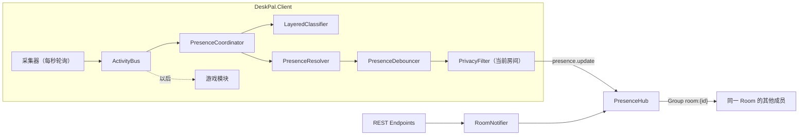

# DeskPal 架构

描述当前代码的实际情况。和原方案 [plan-v1.md](plan-v1.md) 不一致的地方，以本文和 [progress.md](progress.md) 的“偏离方案”为准。

## 组成

| 项目 | 目标框架 | 职责 |
|---|---|---|
| `DeskPal.Shared` | net10.0 | Envelope、消息类型常量、状态和类别枚举、REST DTO、Hub 契约。Server 和客户端都引用 |
| `DeskPal.Server` | net10.0 | ASP.NET Core：Auth、Rooms、Presence（SignalR Hub）、Rules；SQLite |
| `DeskPal.Client.Core` | net10.0 | 不依赖 Windows 的纯逻辑：事件总线、分类器、状态判断、防抖、隐私过滤、面板状态（`Ui/PanelStateBuilder`） |
| `DeskPal.Client` | net10.0-windows10.0.19041.0 | WPF 托盘程序：采集器、Hub 连接、WebView2 宿主窗口，输出文件 `DeskPal.exe`。`web/` 是面板和登录页的前端（Vite + TypeScript + Preact），构建结果复制到输出目录的 `web/` |
| `DeskPal.Tests` | net10.0 | xUnit：分类、状态、Room 生命周期、Hub 集成测试 |

## 数据流

1. 采集器把事实发布到 `ActivityBus`（基于 Channel 的一对多广播）。
2. `PresenceCoordinator` 把信号合并进 `ActivitySnapshot`，分类后得到 `LocalPresence`，交给防抖器。
3. 防抖器提交 `CommittedPresence` 以后，只按当前进入的房间做隐私过滤并发布。切换房间时，先给上一个房间发离线，再给当前房间发状态。已加入但没进入的房间留在列表里，再次进入不用邀请码。分类只使用当前房间的规则。
4. Server 只检查发送者是否为该房间的成员，然后转发给同一 Group 的其他连接，并把最新状态缓存在内存里。

## 采集信号

| 信号 | 来源 | 说明 |
|---|---|---|
| `ForegroundSignal` | `GetForegroundWindow` + 进程信息 + `FileVersionInfo` | 进程名、友好名称、窗口标题、是否全屏、是否浏览器 |
| `BrowserDomainSignal` | UI Automation 读地址栏 | 只取 host，3 秒超时，切换标签后最多约 2 秒才更新 |
| `IdleSignal` | `GetLastInputInfo` | 超过 `IdleMinutes`（默认 5）无输入 |
| `LockSignal` | `SystemEvents.SessionSwitch` | 锁屏和解锁 |
| `MediaSignal` | WinRT `GlobalSystemMediaTransportControlsSessionManager` | 是否在播放、标题、来源应用 |

## 分类

`LayeredClassifier` 按层匹配，命中即停止。

- 前台是浏览器：先查当前房间的规则，再查个人规则。都没有命中时归为 `Browsing`，应用名用域名（没有域名则为空），详情用去掉浏览器后缀的窗口标题。不使用内置的网站和标题规则，也不因为全屏或正在播放而归成视频。房间规则和个人规则里仍然先按域名（取最具体的后缀），再按标题关键词，最后按进程名。`Shopping`、`Social`、`News`、`Reading` 的规则跳过，结果仍是正在浏览网页。
- 其他应用：当前房间的规则 → 个人规则 → 内置规则 → 推测 → `Other`，只按进程名匹配。
- 推测层只对非浏览器、且前几层都没命中时生效：路径含 `\steamapps\` 的程序归为 `Game`；全屏且正在播放媒体归为 `Video`。正在播放媒体本身不分类，避免后台音乐盖过当前焦点。
- 进入房间时，「纠正分类」只写入当前房间的规则，房间内所有成员都按这条规则识别。没有进入房间时，才写入本机 `%APPDATA%\DeskPal\personal-rules.json`。分类只加载当前进入的房间的规则。
- 内置规则保存在 `builtin-rules.json`（目前版本 3，190 条），Server 启动时写入数据库；客户端启动时带上已缓存的版本号请求，版本相同就不返回规则。里面的网站和标题规则不参与浏览器的默认分类。版本 3 起没有 `Music`、`Shopping`、`Social`、`News`、`Reading`。
- 分类口径：桌面应用里，企业微信、飞书、钉钉、Slack、Teams、邮箱和会议软件归为 `Work`；QQ、微信、Telegram 等个人聊天归为 `Communication`。浏览器里的网页不再按网站种类细分。音乐播放器、Kindle、calibre、Discord 没有单独类别，显示为“正在使用 XX”。

## 状态判断和防抖

`PresenceResolver` 的优先级：暂停分享 → 手动状态（`Custom`）→ 锁屏 → 空闲（`Away`，全屏播放视频时除外）→ 分类结果。

`PresenceDebouncer`：

- 新状态要持续 `StableSeconds`（默认 30 秒）才提交，`Since` 记为开始出现的时刻。
- 暂停分享、手动状态、锁屏，进入和退出都立即提交。
- 状态不变、只是详情变了（例如切换到另一个视频），按同样的间隔限频。

不采集麦克风，也不再产生 `Meeting`。`Meeting` 留在 `PresenceState` 和 `ActivityCategory` 里，收到时显示为“工作中”。

## 界面文案

`PresenceFormatter.Format` 把状态拆成三行：标题（工作中、在聊天、正在浏览网页、正在使用 XX、在看视频、在放松、暂时离开、已锁屏等）、应用名、详情。浏览器的应用名是域名，详情是页面标题；两个都有就都显示，只有其中一个就显示那一个。详情超过 36 个字时在界面上截断并加“…”，共享出去的 `Detail` 不截断。文案用书面用语，不用“忙”“摸鱼”。

## 界面

托盘图标和托盘菜单是 WPF 原生的。面板和登录页是 HTML，放在标准 `WebView2` 控件里：

| 窗口 | 文件 | 内容 |
|---|---|---|
| 面板 | `Ui/PanelWindow.cs`、`Ui/PanelBridge.cs` | 三个标签页：状态（房间成员卡片、我的状态、手动状态）、房间（列表、创建和加入、改名、邀请码、转让、退出、解散、隐私设置）、设置（账号和退出登录、开机自启、窗口置顶、测试版、检查更新）。大小固定为 420×680，不能调整。第一次打开时停靠在屏幕右下角，关闭只隐藏。托盘菜单只有「打开 DeskPal」和「退出」 |
| 登录 | `Ui/LoginWindow.cs` | 登录和注册。在 Room、Hub 等服务启动之前显示，所以是单独的窗口 |

- 前端从安装目录的 `web/` 加载，虚拟主机名 `app.deskpal.example`，不开本地端口。跳到其他来源的链接用系统浏览器打开。
- WebView2 用户数据目录：安装版是 `<安装目录>\WebView2`，直接运行时是 `%LOCALAPPDATA%\DeskPal\WebView2`。不放在 Velopack 每次更新都会替换的 `current\` 下。
- 面板隐藏 5 分钟后释放 WebView2，它的进程随之退出；再打开时重新加载，约 0.5 秒。
- 更新的确认和提示（`UpdateInteraction`）通过 `IUserPrompt` 显示在面板里；面板不可用时退回系统对话框。手动检查一点击，设置页就显示「正在检查更新…」，按钮变为「请稍候…」；开始下载后改为「正在下载新版本 x（百分比）」。检查更新不弹出 Windows 通知气泡。后台每 6 小时的检查不显示这些过程，下载完成后设置页的「立即重启并更新」变为可用。
- 启动时检测 WebView2 Runtime。没有时用系统对话框提示下载：已登录时采集和同步照常，只是面板打不开；未登录时无法登录。

宿主和页面之间用 JSON 消息通信（`PostWebMessageAsJson` / `chrome.webview.postMessage`），类型定义在 `web/src/bridge.ts`：

| 方向 | 消息 |
|---|---|
| 宿主 → 页面 | `state`（完整的 `PanelState`，变化后最多每 200 毫秒推一次）、`result{id, ok, error, data}`、`dialog{id, kind, message}`、`login{serverUrl, userName}` |
| 页面 → 宿主，要回复 | `{id, type, ...}`：`room.*`、`member.poke`、`presence.pause / manual / correct`、`settings.autoStart / topmost`、`update.check / beta / restart`、`auth.login / register / logout` |
| 页面 → 宿主，不回复 | `ready`、`dialog.answer{dialogId, ok}` |

`PanelState` 由 `PanelStateBuilder` 在 Client.Core 里生成，界面上的文字（连接状态、空提示、规则来源、“该房间成员看到”）都在 C# 里算好，页面只负责显示。页面写「房间」，不写 Room。`PanelFixtureTests` 把几组样例序列化到 `web/src/mock/fixtures/`，不一致就失败，改了 `PanelState` 或文案后用 `DESKPAL_UPDATE_FIXTURES=1` 运行测试更新。

在浏览器里调试：`cd src/DeskPal.Client/web; npm run dev`，打开 `http://localhost:5190/`。没有 `chrome.webview` 时页面用模拟宿主，参数 `?mock=default|no-room|guest` 切换样例，`?fail` 让所有命令失败，`?page=login` 打开登录页，发出的命令记录在 `window.__sent`。Debug 版客户端设置环境变量 `DESKPAL_UI_URL=http://localhost:5190/` 可以直接加载开发服务器。

## 隐私

- 隐私级别按 Room 和类别分别配置：`StateOnly`（只显示状态）、`Category`（再加类别和应用名）、`Detail`（再加窗口标题或媒体标题）。
- 默认值：`Work`、`Meeting`、`Communication` 为 `StateOnly`，其他类别为 `Category`。没有人默认开启 `Detail`。
- 过滤在客户端完成，原始标题不经过 PrivacyFilter 就不会离开本机。
- Envelope 的 `Enc` 字段预留给端到端加密，Server 不解析 Payload。

## REST 接口

除注册、登录、`/health` 和内置规则外都要求 `Authorization: Bearer <token>`。错误返回 `{ "error": "中文说明" }`。

| 方法 | 路径 | 说明 |
|---|---|---|
| POST | `/api/auth/register` | 注册，返回 `AuthResponse`（含 token，有效期 30 天） |
| POST | `/api/auth/login` | 登录 |
| GET | `/api/me` | 当前用户 |
| GET | `/api/rooms` | 我加入的 Room |
| POST | `/api/rooms` | 创建 Room（每人最多拥有 `MaxOwnedRoomsPerUser` 个） |
| POST | `/api/rooms/{id}/invites` | 生成邀请码，旧邀请码失效，24 小时过期。同时删除踢出记录，被踢出的人可以用新邀请码加入 |
| POST | `/api/rooms/join` | 用邀请码加入（人数上限 `MaxMembersPerRoom`，默认 50）。被踢出且邀请码尚未更新时返回 403 |
| POST | `/api/rooms/{id}/leave` | 退出；所有者退出返回 409。退出后可以用邀请码再次加入 |
| POST | `/api/rooms/{id}/kick` | 所有者踢出成员（`KickMemberRequest`）。对方从房间列表消失。生成新邀请码后可以再加入 |
| POST | `/api/rooms/{id}/transfer` | 所有者转让所有权 |
| PUT | `/api/rooms/{id}` | 所有者修改 Room 名称（`RenameRoomRequest`，去掉首尾空格后 1 到 30 个字符）；名称有变化时广播 `room.renamed` |
| DELETE | `/api/rooms/{id}` | 所有者解散，级联删除成员、邀请码、房间规则和踢出记录 |
| GET/PUT | `/api/rooms/{id}/privacy` | 我在该 Room 的隐私配置 |
| GET/PUT | `/api/rooms/{id}/rules` | Room 规则；PUT 按（种类，标准化后的内容）新增或覆盖 |
| GET | `/api/rules/builtin?version=N` | 内置规则；版本相同时 `rules` 为 null |
| GET | `/health` | 健康检查，返回 `status` 和 `revision`（镜像构建时的 Git 提交号，本地运行为空） |

## Hub

路径 `/hubs/presence`，token 通过查询参数 `access_token` 传递。客户端调用 `Publish(Envelope)`，接收 `Receive(Envelope)`。

| 类型 | 发送方 | Payload | 说明 |
|---|---|---|---|
| `presence.update` | 客户端 | `PresenceSnapshot` | 客户端只向当前进入的房间发布，切换时向上一个房间发离线。Server 缓存最新一条；新连接会收到同房间其他人的缓存；最后一个连接断开时，Server 向该用户加入的每个房间广播 `Offline` |
| `interaction.poke` | 客户端 | `PokePayload(Text, TargetUserId)` | 对方显示托盘气泡；对方离线时丢失 |
| `room.memberJoined` / `room.memberLeft` | Server | `RoomEventPayload(UserId)` | 同时增删 SignalR Group |
| `room.kicked` | Server | `RoomEventPayload(被踢出的人)` | 只发给被踢出的人。客户端提示邀请码更新后才能再次加入，并重新拉取房间列表 |
| `room.ownerChanged` | Server | `RoomEventPayload(新所有者)` | |
| `room.renamed` | Server | `RoomEventPayload(null)` | 客户端重新拉取 Room 列表 |
| `room.dissolved` | Server | `RoomEventPayload(null)` | 之后所有成员移出 Group |
| `rules.roomRulesChanged` | Server | `RoomEventPayload(修改人)` | 客户端重新拉取 Room 规则 |

## 数据模型（SQLite，本地 `storage/deskpal.db`，容器内 `/data/deskpal.db`）

| 表 | 主要字段 |
|---|---|
| `Users` | Id、UserName（唯一）、DisplayName、PasswordHash（PBKDF2）、CreatedAt |
| `Rooms` | Id、Name、OwnerId、MaxMembers、CreatedAt |
| `RoomMembers` | RoomId + UserId、Role、JoinedAt、PrivacyProfileJson（为空时用默认值） |
| `RoomInvites` | Code、RoomId、CreatedBy、ExpiresAt |
| `RoomBans` | RoomId + UserId、BannedBy、BannedAt。生成新邀请码时删除，被踢出的人即可用新邀请码加入 |
| `RoomRules` | RoomId、Kind、Pattern、Category、Name、CreatedBy、UpdatedAt |
| `BuiltinRules` / `AppMeta` | 内置规则和规则库版本号 |

实时状态、连接、在线情况只在内存里（`PresenceStore`、`ConnectionRegistry`），Server 重启后清空。

## 客户端本地文件

设置和规则在 `%APPDATA%\DeskPal`，卸载不会删除。日志和 WebView2 缓存在安装目录（Velopack 的根目录，`current\` 的上一级）：自动更新时保留，卸载或在同一目录重新安装时随目录一起清空（安装向导会先保留 `logs\`）。直接运行或安装目录不可写时，日志回到 `%APPDATA%\DeskPal\logs`，缓存回到 `%LOCALAPPDATA%\DeskPal\WebView2`，见 `Services/AppPaths.cs`。以前版本写在 `%APPDATA%\DeskPal\logs` 的旧日志不迁移。

| 文件 | 内容 |
|---|---|
| `settings.json` | Server 地址（默认 `https://deskpal.hafuhafu.cn:36443`）、当前用户、DPAPI 加密的 token、选中的 Room、空闲和防抖参数、暂停和手动状态、是否加入测试版（`includePrerelease`，空则沿用安装渠道） |
| `personal-rules.json` | 个人规则 |
| `builtin-rules.json` | 内置规则缓存 |
| `<安装目录>\logs\deskpal.log` | 客户端运行日志。超过 1 MB 后改名为 `deskpal-时间.log`，最多保留 5 个旧文件，超过 7 天的旧文件删除。不记录窗口标题、媒体标题、域名、页面标题、手动状态、戳一下内容、密码、token、邀请码 |
| `<安装目录>\logs\setup.log` | 最近一次通过安装向导安装时 Velopack Setup.exe 的日志 |

`settings.json` 里还有窗口置顶（`topmost`）。WebView2 的缓存在 `<安装目录>\WebView2`。开机自启写入 `HKCU\Software\Microsoft\Windows\CurrentVersion\Run`；用命名 Mutex 保证单实例运行。

## 部署和发布

细节见 [deploy/README.md](../deploy/README.md)。

| 环节 | 做法 |
|---|---|
| Server 镜像 | `.github/workflows/docker.yml`：推送默认分支或 `v*` 标签时用 `deploy/Dockerfile.server` 构建，推到 `ghcr.io/hulushilei/deskpal-server` |
| Server 运行 | Portainer Stack（`deploy/stack.yml`），在 192.168.66.5 上发布 18820 端口；`Jwt__Key` 来自 Stack 环境变量 `DESKPAL_JWT_KEY` |
| 自动更新 | main 上的镜像同时推 `latest` 和 `sha-<提交号>`。GitHub Actions POST `PORTAINER_WEBHOOK_URL?tag=sha-<提交号>`，再等到 `/health` 的 `revision` 等于该提交号。Traefik 只在 36443 上公开 webhook token 路径 |
| HTTPS | 192.168.66.10 上已有的 Traefik：`deskpal.hafuhafu.cn` 走 443 和 36443 两个入口，`*.hafuhafu.cn` 泛域名证书（阿里云 DNS challenge）；路由文件 `/etc/traefik/conf/deskpal.yml`，仓库里的副本是 `deploy/traefik-dynamic.yml` |
| 客户端 | `.github/workflows/ci.yml`：main 上改了客户端时用 Velopack 发测试版 Pre-release（通道 `beta`，版本 `x.y.z-dev.<运行号>`，安装包 `DeskPal-<版本>-Setup.exe`，测试版版本号形如 `0.1.2-dev.15`），只保留最近 8 个；手动推送 `vX.Y.Z` 发正式版（通道 `win`，安装包同样是 `DeskPal-<版本>-Setup.exe`，例如 `DeskPal-0.1.2-Setup.exe`）。安装包是 Inno Setup 向导（`installer/DeskPal.iss`，CI 下载 Inno Setup 6.7.3 并校验 SHA256 后编译），内嵌 `vpk pack` 生成的 Setup.exe；用户选好目录后用 `--installto` 静默安装。Release 上只放这个向导，Velopack 自带的 Setup.exe 上传后删除，自动更新只用 nupkg 和 releases 清单。已安装的客户端启动后和每 6 小时向 GitHub Release 检查更新，后台下载；只在退出或选择立即重启时安装，启动时不自动安装。取消测试版会删除已下载的包。打包时带 `--framework webview2`，安装程序和每次更新前都会检查 WebView2 Runtime，缺少时自动安装。CI 先用 Node 22 构建 `web/`。Release 说明附带更新内容：测试版列出上一次发布以来的提交标题，正式版列出上一个正式版以来的提交标题 |
