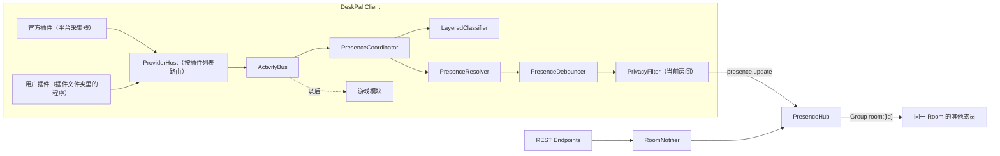

# DeskPal 架构

描述当前代码的实际情况。和原方案 [plan-v1.md](plan-v1.md) 不一致的地方，以本文和 [progress.md](progress.md) 的“偏离方案”为准。

## 组成

| 项目 | 目标框架 | 职责 |
|---|---|---|
| `DeskPal.Shared` | net10.0 | Envelope、消息类型常量、状态和类别枚举、REST DTO、Hub 契约。Server 和客户端都引用 |
| `DeskPal.Server` | net10.0 | ASP.NET Core：Auth、Rooms、Presence（SignalR Hub）、Rules；SQLite |
| `DeskPal.Client.Core` | net10.0 | 不依赖 Windows 的纯逻辑：事件总线、分类器、状态判断、防抖、隐私过滤、面板状态（`Ui/PanelStateBuilder`） |
| `DeskPal.Client.App` | net10.0 | Windows、macOS、Linux 共用的客户端服务：`ApiClient`、`HubService`、`RoomState`、`PresenceCoordinator`、统计和同步、`UpdateService`、面板命令 `PanelBridge`、启动流程 `ClientStartup`。平台能力通过 `Platform/IClientPlatform`（文件对话框、剪贴板、开机自启、打开链接、后备提示框）和 `ISecretProtector`（`SecretProtection.Current`）注入 |
| `DeskPal.Client` | net10.0-windows10.0.19041.0 | WPF 托盘程序：Windows 官方插件（采集器）、`WindowsPlatform`、DPAPI、WebView2 宿主窗口，输出文件 `DeskPal.exe`。`web/` 是面板和登录页的前端（Vite + TypeScript + Preact），构建结果复制到输出目录的 `web/`，macOS 版共用 |
| `DeskPal.Client.Mac` | net10.0-macos（macOS 13+） | macOS 菜单栏程序：macOS 官方插件（采集器）、`MacPlatform`、WKWebView 宿主窗口，输出 `DeskPal.app`。见下文「macOS 客户端」 |
| `DeskPal.Client.Linux` | net10.0 | Linux 托盘程序：Linux 官方插件（X11 或 GNOME 扩展读窗口、浏览器扩展读网站、空闲、锁屏、媒体）、`LinuxPlatform`、WebKitGTK 宿主窗口，发布为 AppImage。见下文「Linux 客户端」 |
| `DeskPal.Tests` | net10.0 | xUnit：分类、状态、Room 生命周期、Hub 集成测试 |

## 数据流

1. 插件提供事实：每个平台的官方插件（原来的采集器）和用户放进插件文件夹的插件。`ProviderHost` 按插件列表决定每一项事实用谁的（见下文「插件」），只把被采用的发布到 `ActivityBus`（基于 Channel 的一对多广播）。
2. `PresenceCoordinator` 把信号合并进 `ActivitySnapshot`，分类后得到 `LocalPresence`，交给防抖器。
3. 防抖器提交 `CommittedPresence` 以后，只按当前进入的房间做隐私过滤并发布。切换房间时，先给上一个房间发离线，再给当前房间发状态。已加入但没进入的房间留在列表里，再次进入不用邀请码。选「无房间」（`AppSettings.NoRoom`，或一个房间都没有）时 `RoomState.SelectedRoom` 为 null，所有房间都收到离线，之后不发布状态；选择、创建或加入房间时清除。分类和房间无关，切换房间不改变分类结果。
4. Server 只检查发送者是否为该房间的成员，然后转发给同一 Group 的其他连接，并把最新状态缓存在内存里。

## 插件

活动事实分五项能力（`ProviderCapability`）：`foreground` 当前窗口、`domain` 浏览器网站、`idle` 暂离、`lock` 锁屏、`media` 正在播放。三个平台都由插件提供，没有绕过插件的采集路径。

| 部件 | 位置 | 作用 |
|---|---|---|
| `IActivityProvider` | Client.App/Providers | 一个插件：Id、提供哪几项（可以运行中变化）、健康状态、状态说明（`PluginNote`）、按钮 |
| `OfficialProvider` | Client.App/Providers | 平台官方插件：把采集器作为一组在程序内运行。每次启动用 `ActivatorUtilities` 新建采集器，传入这次运行的 `SignalSink`；关掉插件就真正停掉采集器。平台用 `AddOfficialProvider` 注册；Linux 用子类 `LinuxOfficialProvider` |
| `ExternalProvider` | Client.App/Providers | 用户插件：插件文件夹里的程序，标准输出每行一个 JSON（协议 v1，`Client.Core/Providers/ProviderProtocol`）。每秒最多 50 行，退出后按 1/2/5/10/30/60 秒重启；暂离把插件报的秒数交给 `IdleTracker` 按用户设置判断 |
| `PluginFiles` | Client.App/Providers | 哪些文件算插件、怎么启动。Windows：`.exe`、`.cmd`/`.bat`、`.ps1`、`.py`；macOS、Linux：有可执行位的文件 |
| `ProviderRouting` / `CapabilityRouter` | Client.Core/Providers | 路由：每项能力取列表里最上面一个开启且没有出错的、声明了它的插件。主人变了，补发新主人上次报的值（采集器只在变化时报）；没人提供时发清空值（无网站、不暂离、不锁屏、没在播放；当前窗口保持上一个） |
| `ProviderHost` | Client.App/Providers | 管理列表：合并官方插件、设置里的顺序和插件文件夹（每 10 秒和点“刷新”时重新读）；启停插件；把信号按路由发到 `ActivityBus`；实现设置页用的 `IProviderControl` |

列表顺序和开关存在 `AppSettings.Plugins`（`{ id, enabled, provides }`），只在本机。新出现的官方插件加在末尾并开启；插件文件夹里新出现的文件加在最上面并关闭，开启时界面会确认。用户插件 hello 里声明的能力记在 `provides`，下次启动前列表就能显示对。

插件文件夹：Windows `%APPDATA%\DeskPal\plugins`，macOS `~/Library/Application Support/DeskPal/plugins`，Linux `~/.config/DeskPal/plugins`。

设置页「插件」一节（`PluginsView`）全平台都有：每个插件显示提供的能力，高亮的是实际在用的；可以开关、上下移动；显示状态说明和插件提供的按钮；没人提供的能力在顶部提示。

插件只陈述事实。分类、不记录标题、隐私过滤都在插件之后执行，和以前一样。写插件见 [provider-guide.md](provider-guide.md)。

## 官方插件的采集方式

Windows 官方插件（`official:windows`）：

| 信号 | 来源 | 说明 |
|---|---|---|
| `ForegroundSignal` | `GetForegroundWindow` + 进程信息 + `FileVersionInfo` | 进程名、友好名称、窗口标题、是否全屏、是否浏览器 |
| `BrowserDomainSignal` | UI Automation 读地址栏 | 只取 host，3 秒超时，切换标签后最多约 2 秒才更新 |
| `IdleSignal` | `GetLastInputInfo` | 超过 `IdleMinutes`（默认 5）无输入 |
| `LockSignal` | `SystemEvents.SessionSwitch` | 锁屏和解锁 |
| `MediaSignal` | WinRT `GlobalSystemMediaTransportControlsSessionManager` | 是否在播放、标题、来源应用 |

macOS 官方插件（`official:macos`）见下文「macOS 客户端」，Linux 官方插件（`official:linux`）见「Linux 客户端」。

## 分类

`LayeredClassifier` 按层匹配，命中即停止。

- 前台是浏览器：先查个人分类，没有命中时，正在播放当前标签页的视频（媒体标题包含在标签页标题里）归为 `Video`，否则归为 `Browsing`；应用名用域名（没有域名则为空），详情用去掉浏览器后缀的窗口标题。不使用内置的网站和标题规则。个人分类里先按域名（取最具体的后缀），再按标题关键词，最后按进程名。`Shopping`、`Social`、`News`、`Reading` 的规则跳过，结果仍是正在浏览网页。
- 其他应用：个人分类 → 内置规则 → 推测 → `Other`，只按进程名匹配。
- 推测层只对非浏览器、且前几层都没命中时生效，依次是：
  - 路径落在规则库 `folders` 列出的游戏库目录（`\steamapps\common\`、`\Epic Games\`、`\WeGameApps\` 等）的程序，归为该目录的类别（目前都是 `Game`）。启动器、崩溃上报、更新程序除外。规则库还没下发目录时（旧 Server 或旧缓存）用 `LayeredClassifier.DefaultFolders`。
  - 文件名是 Unreal 发行版（`xxx-Win64-Shipping`、`xxx-Mac-Shipping`）的程序，在哪里都归为 `Game`。
  - 全屏且正在播放媒体，归为 `Video`。正在播放媒体本身不分类，避免后台音乐盖过当前焦点。
- 推测出来的游戏由 `GameNames` 取名，因为游戏程序的文件描述常常是 `b1-Win64-Shipping`、引擎名，或者是空的。取名顺序：Steam 库里 `appmanifest_*.acf` 的 `name`（按 `installdir` 对应 `steamapps\common\` 下的文件夹，每个库最多 5 分钟重扫一次）→ 能读的文件描述 → 游戏库目录下一级的文件夹名 → Unreal 项目的根目录（`<游戏>\<项目>\Binaries\Win64\`）→ 去掉 `-Win64-Shipping` 后的文件名。

### 个人分类

- 「纠正分类」和「待归类」写入个人分类，所有房间通用，只影响自己的识别结果。2026-11-19 起以本机为准，见下面的「个人数据」；开启「同步到账号」后同时写入 Server 的 `UserRules` 表（`PUT /api/me/rules`）。没有房间规则：同一个应用，房间里每个人可以有不同的分类。
- 识别结果照常经过隐私过滤后广播，所以别人看到的是你自己的分类，例如“工作中 · 微信”。新加入的房间所有类别默认只显示状态，要在该房间把工作改成“显示类别和应用”，别人才看得到应用名。
- 开启同步时，修改后 Server 只给该用户自己的连接发 `rules.personalChanged`，客户端重新拉取个人分类和不记录标题。
- 每人最多 500 条；`Meeting` 和退役类别不能设置。「规则」页的「分类」可以搜索、修改和删除，状态页对当前应用提供「恢复默认」。

### 个人数据

个人分类、不记录标题的规则、暂离时长和偏好设置（切换等待、外观、语言、关闭窗口时、窗口置顶、成员排序）统称个人数据，2026-11-19 起以本机为准，除本机外可以保存到下面三处之一。

- 本机：`PersonalDataStore` 写 `%APPDATA%\DeskPal\personal\<userId>.json`（`PersonalData`：个人分类、不记录标题、删除记录），换账号时不用别人的数据。偏好设置和暂离时长仍在 `settings.json`。第一次启动时把旧的 `personal-rules.json` 和 `settings.json` 的 `noTitleRules` 迁移进来。
- 同步到账号（`Users.PersonalSync`，默认关闭）：设置页开启前弹出警告，说明这些内容明文保存在服务器。开启时客户端把本机的个人数据发给 `POST /api/me/personal-sync`，Server 按每条规则的修改时间合并（客户端的时间晚于 Server 当前时间时按当前时间），偏好设置以账号为准，账号还没有暂离时长时用本机值，返回合并结果，客户端整份替换本机。之后修改先写 Server，再写本机。关闭时 `DELETE /api/me/personal-sync` 删除 Server 上的个人分类、不记录标题、暂离时长和偏好设置，本机保留。关闭期间个人分类和不记录标题的读写、暂离时长和偏好设置的写入返回 403 `personalSync.off`，客户端收到后把本机开关也关掉，本机数据保留，修改只保存在本机。读取也返回 403，是为了关闭时 Server 发出的 `rules.personalChanged` 不会让各台电脑拉到空列表、覆盖本机数据。迁移 `AddPersonalSync` 把 Server 上已有个人分类、偏好设置或暂离时长的账号设为开启，其他账号默认关闭。
- 同步文件夹：和使用统计的同步文件夹一样由用户自己的网盘同步，每台电脑写 `<文件夹>\DeskPal\<userId>\personal\<deviceId>.json`（`PersonalFile`，明文），读其他电脑的文件，每 2 分钟一次，修改后立即写。可以和使用统计用同一个文件夹（统计只读以设备号命名的目录）。按 `PersonalMerge` 合并：同一条（种类，内容）以最近修改的为准，删除也算修改，删除记录保留 90 天；偏好设置整份以修改时间晚的为准。和同步到账号只能开启一种。退出登录时停止。
- 导入导出：`PersonalFile` 格式的 JSON（`format` 为 `deskpal-personal`），含个人分类、不记录标题、偏好设置和暂离时长。导入时文件里的规则覆盖本机相同的规则，并按导入时间算作修改，其他规则保留；开启了同步到账号时一并合并到 Server。

规则库候选：开启同步的账号仍从 `UserRules` 统计；未开启、同意分享使用数据的账号，`UsageReporter` 在使用上报里附带应用（进程名）个人分类（`UsageReportRequest.Rules`，只有进程名、类别、名称），Server 存进 `SharedRuleReports`，每次上报整份替换，关闭分享或开启同步时删除。

### 未识别应用和规则库候选

- `UnclassifiedUsage` 统计当天每个没有规则的桌面应用的前台时长，包括落到 `Other` 的，和推测层推测出类别的（记下推测的类别 `Guessed`）：两次记录间隔超过 30 秒的不计，本地零点清零。`UnclassifiedUsageStore` 每分钟和退出时写入 `unclassified-<userId>.json`，启动时只恢复当天的记录，重启后继续累计，上报的分钟数不会变小。浏览器网页不统计。状态页的「待归类」只列出落到 `Other` 的，今天用了 5 分钟以上的前 5 个；推测出类别的已经显示为在玩游戏，不列。
- 第一次打开面板时询问是否分享使用数据（`Users.ShareUsage`，空表示还没问过），设置页可以随时改。关闭时删除已上报的数据。
- 同意分享时，`UsageReporter` 每 2 小时上报今天用了 10 分钟以上的这些应用（进程名、应用名称、推测的类别、分钟数，`POST /api/me/usage`），不含窗口标题、网页和具体时间。推测出来的游戏，应用名称就是上面 `GameNames` 取的名字。Server 只接受 `Game`、`Video` 作为推测的类别。
- `GET /api/rules/candidates` 只统计同意分享、注册满 `Rules:MinAccountAgeDays`（默认 3）天的账号，一个账号一票。个人分类按应用分组，取占比最高的类别，和内置规则相同的跳过：
  - 多人一致（`consensus`）：至少 `Rules:MinUsers`（默认 2）个账号设置过，占比最高的类别不低于 `Rules:MinAgreement`（默认 0.66）。
  - 待确认的改动（`signals`）：达不到上面的门槛，但至少 `Rules:ReviewMinUsers`（默认 1）个账号设置过。内置规则里已有、只是有人改了分类的应用在这里出现，例如一个人把 Codex 改成其他。
  - 推测一致（`guessed`）：内置规则和任何人的个人分类都没有覆盖，至少 `MinUsers` 个账号上报过，多数人推测的类别不为空。
  - 未识别应用（`unknown`）：内置规则和个人分类都没有覆盖、不属于 `guessed` 的，至少 `ReviewMinUsers` 个账号上报过，最多 100 个。
- 该接口要求请求头 `X-DeskPal-Maintainer` 等于 `Rules:MaintainerToken`，口令为空时返回 404。`.github/workflows/rule-candidates.yml` 每天北京时间 9:17 请求一次（避开整点）：`consensus` 和 `guessed` 写进 `builtin-rules.json` 并开 PR（`guessed` 写成带名称的规则，以后不再依赖安装路径），人工审核后合并；`signals` 和 `unknown` 需要人工判断，写进 PR 说明，同时更新 issue「内置规则库：待人工确认」（没有文件改动时开不了 PR）。
- 内置规则保存在 `builtin-rules.json`（目前版本 10，413 条，其中约 70 条是 Mac 应用的 Bundle ID，中文名称都带 `names.en`；另有 `folders` 列出 11 个游戏库目录），Server 启动时把规则写入数据库、目录写入 `AppMeta`；客户端启动时带上已缓存的版本号请求，版本相同就不返回规则。缓存里还没有目录的客户端按版本 0 请求，拿一次完整的规则库。目录放在单独的字段里，不是新的 `RuleKind`，旧客户端不认识新枚举值会读不了整个规则库。里面的网站和标题规则不参与浏览器的默认分类。版本 3 起没有 `Music`、`Shopping`、`Social`、`News`、`Reading`。
- 分类口径：桌面应用里，企业微信、飞书、钉钉、Slack、Teams、邮箱和会议软件归为 `Work`；QQ、微信、Telegram 等个人聊天归为 `Communication`。浏览器里的网页不再按网站种类细分。音乐播放器、Kindle、calibre、Discord 没有单独类别，显示为“其他活动”和应用名。

## 状态判断和防抖

`PresenceResolver` 的优先级：暂停分享 → 锁屏 → 空闲（`Away`，全屏播放视频时除外）→ 分类结果。

`PresenceDebouncer`：

- 新状态要持续「切换等待」的秒数才提交（`switchDelaySeconds`，跟随账号，可选 0、3、5、10、30，默认 10；0 表示立即提交），`Since` 记为开始出现的时刻。设置里修改后立即生效，正在等待的新状态按新的时长计算。只影响推送给房间的状态，使用统计由 `UsageRecorder` 按防抖前的状态记录，不受影响。`PresenceCoordinator` 在到期时刻再判定一次，不等下一次 5 秒的定时判定。
- 状态页「我的状态」大字显示已提交的状态，按当前房间的隐私设置过滤，和房间成员看到的一致；鼠标指向状态、应用名、标题时，用气泡显示不经过滤的类别、应用和标题（`PanelState.me.full`），只给自己看，不上报。无房间时不过滤。有待提交的新状态时，标题行右侧显示「n 秒后变为」和新状态（同样过滤），标题行不足 300px 时缩成「n 秒 →」，仍是一行；进度条贴在卡片底边，不改变卡片高度；`PanelState.me.pending` 给出剩余毫秒，页面自己倒数，指向倒计时显示新状态的完整内容（`pending.full`）和识别方式。房间成员还没有收到过状态时，右上角不显示文字。只有详情变了的，直接显示本机的新详情，不显示倒计时。
- 暂停分享、锁屏，进入和退出都立即提交。
- 状态不变、只是详情变了（例如切换到另一个视频），按同样的间隔限频，但间隔不少于 10 秒（`SwitchDelay.MinDetailInterval`），避免选「不等待」时标题频繁变化的窗口不停推送。

不采集麦克风，也不再产生 `Meeting`。`Meeting` 留在 `PresenceState` 和 `ActivityCategory` 里，收到时显示为“工作中”。

## 界面文案

`PresenceFormatter.Format` 把状态拆成三行：标题（工作中、在聊天、正在浏览网页、其他活动、在看视频、在放松、暂离、已锁屏等，不带应用名）、应用名、详情。浏览器的应用名是域名，详情是页面标题；页面上标题一行，应用名和详情合成一行（“应用 · 详情”），只有其中一个就显示那一个。应用名和详情去掉首尾空白后相同（不区分大小写）时，详情不再显示，避免出现“QQ · QQ”。`Tone`（work、chat、relax、browse、other、away、offline）决定标题、状态标签和头像底色的颜色。状态页成员行的「已持续多久」放在右侧按钮下方、和状态标签同一行，靠右对齐，位置不随状态文案长短和按钮数量变化。详情超过 36 个字时在界面上截断并加“…”，共享出去的 `Detail` 不截断。文案用书面用语，不用“忙”“摸鱼”。

## 多语言

客户端支持简体中文和英文，所有给用户看的文字都来自客户端，Server 不做多语言。

- 语言设置在 `settings.json` 的 `language`：`system`（默认，跟随 Windows 显示语言，中文显示语言用简体中文，其他一律英文）、`zh-CN`、`en`。启动时（登录窗口之前）由 `UiLanguage.Apply` 设置 `Strings.Culture`；设置页改了之后发 `settings.language`，立即生效：托盘菜单重设文字，`PanelState` 按新语言重新生成并推送。
- C# 生成的文字（`PanelState`、统计页、托盘、对话框、命令错误、更新提示、房间通知）在 `DeskPal.Client.Core/Localization/Strings.resx`（中文，中性资源）和 `Strings.en.resx`。日期、星期和时长的格式也在资源里，用 `UiLanguage.Format` 按当前语言格式化。
- 页面自己的文字（按钮、标题、对话框）在 `web/src/i18n/zh-CN.ts` 和 `en.ts`，用 `t(key, vars)`。初始语言来自页面地址的 `lang` 参数（`WebUi.Page` 加上），之后跟随 `PanelState.locale`；置顶小卡片跟随 `card` 消息的 `locale`。
- Server 的错误只返回错误码和参数：`{ "code": "room.full", "args": { "limit": "20" } }`，错误码在 `DeskPal.Shared/Api/ApiErrorCodes.cs`。客户端 `ApiErrorText` 按 `ApiError_<码>` 查资源并代入参数；不认识的错误码显示「请求失败（HTTP 状态码）」。
- 别人的客户端拒绝统计请求时，`stats.response` 带 `errorCode`（`not-shared`、`out-of-range`），请求方按自己的语言显示；旧客户端只带中文 `error`，照原样显示。
- 安装向导（Inno Setup）按 Windows 显示语言选择简体中文或英文。
- 内置规则的应用名：`name` 是默认名称（中文），`names` 是其他语言的名称（目前只有 `en`）。分类、上报、房间成员收到的、本机统计里存的都是默认名称；显示时 `AppNames.Localize` 按本机界面语言和本机缓存的规则库翻译（状态、置顶卡片、悬停说明、纠正分类、统计排行）。旧客户端忽略 `names`，照旧显示中文。
- 只有一种语言的内容：用户输入的名称（显示名称、房间名、个人分类的名称）、应用自己的产品名。更新条目在 `CHANGELOG.md` 里中英各写一行，按界面语言显示。

## 界面

托盘图标和托盘菜单是 WPF 原生的。面板和登录页是 HTML，放在标准 `WebView2` 控件里：

| 窗口 | 文件 | 内容 |
|---|---|---|
| 面板 | `Ui/PanelWindow.cs`、`Ui/PanelBridge.cs` | 标题栏中间是房间切换菜单。左侧导航五页：首页（我的状态、房间成员、待归类；公开了使用统计且当前在线的成员行右侧有统计按钮，离线后按钮和状态一起消失）、统计（自己和房间成员的使用统计，以及查看记录、导入导出、同步到服务器（只对名单内账号显示）、同步文件夹、清除）、房间（列表、创建和加入、改名、邀请码、屏蔽成员、转让、退出、解散、隐私设置、公开使用统计）、规则（导航图标是漏斗；顶部切换「分类」和「不记录标题」：分类可按应用、网站、类别搜索，修改和删除；不记录标题可添加和删除）、设置（账号和退出登录、开机自启、窗口置顶、关闭窗口时、夜间模式、个人数据（同步到账号、同步文件夹、导入导出）、分享使用数据、测试版、检查更新、问题与建议）。默认 420×680，可以拖动边框调整，最小 400×480，不能最大化；内容最宽 640px 居中。第一次打开时停靠在屏幕右下角。关闭按钮默认弹出选择：最小化、最小化到系统托盘，或直接退出，可勾选不再提示；设置里可以改成每次询问、最小化、最小化到系统托盘或直接退出。托盘菜单只有「打开 DeskPal」和「退出」 |
| 登录 | `Ui/LoginWindow.cs` | 登录和注册。在 Room、Hub 等服务启动之前显示，所以是单独的窗口 |
| 置顶小卡片 | `Ui/MemberCards.cs`、`Ui/MemberCardWindow.cs`、`PinnedMembers`（Client.Core） | 状态页成员行的大头针把该成员置顶到桌面，每人一张 280×84 的卡片（`index.html?page=card`），人数不限。卡片总在最前，不显示在任务栏，不抢焦点；从屏幕右上角往下排，整张可以拖动，双击打开面板，点 × 取消置顶。内容是头像、名字、已持续多久、状态标签，应用名和详情合成一行（C# 算好放在 `card` 消息里）。置顶只存在内存里，属于置顶时所在的房间：切换房间、选「无房间」、该成员退出、被踢出或被我屏蔽时移除，再进入也不恢复，重启后也没有 |

外观按 Windows 11 桌面程序做，不像网页：

- 没有系统标题栏。`Ui/WindowFrame.cs` 用 `WindowChrome`（`CaptionHeight` 0、`GlassFrameThickness` 0）去掉标题栏但保留窗口边框，并通过 DWM 要求圆角，Windows 11 上仍有圆角和阴影。
- 标题栏画在页面里（`TitleBar`）：CSS `app-region: drag` 的区域可以拖动窗口，依赖 WebView2 的 `IsNonClientRegionSupportEnabled`；最小化按钮发 `window.minimize`。面板的关闭按钮按 `CloseAction` 处理：`ask` 先在页面里选择，`minimize` 发 `window.minimize`，`tray` 发 `window.close`（面板只隐藏，不退出），`quit` 发 `window.quit`（和托盘菜单的「退出」相同，停止后台服务后退出）。登录窗口的关闭直接发 `window.close`。
- 颜色默认跟随系统的浅色、深色模式。设置里的「夜间模式」可以改成固定浅色或固定深色，选择记在 `settings.json`。WPF 窗口背景使用同一次选择；跟随系统时仍读注册表 `AppsUseLightTheme`，避免加载时闪白。图标用 Segoe Fluent Icons；开关、设置行、菜单、对话框按 Windows 11 的控件样式写。
- 页面不能选中文字（输入框和 `.selectable` 除外），不显示手形光标，只在键盘操作时显示焦点框；关闭了缩放、滑动导航、自动填充和保存密码。
- 没有 WebView2 Runtime 时，面板退回一个 WPF 提示窗口，可以拖动和关闭。

- 前端从安装目录的 `web/` 加载，虚拟主机名 `app.deskpal.example`，不开本地端口。跳到其他来源的链接用系统浏览器打开。
- WebView2 用户数据目录：安装版是 `<安装目录>\WebView2`，直接运行时是 `%LOCALAPPDATA%\DeskPal\WebView2`。不放在 Velopack 每次更新都会替换的 `current\` 下。
- 面板隐藏 5 分钟后释放 WebView2，它的进程随之退出；再打开时重新加载，约 0.5 秒。
- 面板打开后 15 秒内页面没有发来 `ready`，或者 WebView2 的浏览器进程、渲染进程退出或无响应，就释放当前 WebView2 重新创建；连续 3 次不成功时显示 WPF 提示，关闭后再打开会重新尝试。每次创建都新建 `CoreWebView2Environment`，不复用浏览器进程已退出的环境。加载的开始、耗时和失败原因写进客户端日志。
- 托盘左键单击打开或隐藏面板。双击的第二下不算（按系统双击间隔），面板刚显示不到 1 秒时单击也只打开不隐藏；启动过程中托盘已出现、面板还没创建时的单击，会在启动完成后打开面板。
- 更新的确认和提示（`UpdateInteraction`）通过 `IUserPrompt` 显示在面板里；面板不可用时退回系统对话框。手动检查一点击，设置页就显示「正在检查更新…」，按钮变为「请稍候…」；开始下载后改为「正在下载新版本 x（百分比）」，增量包下完、合成安装包期间改为「正在准备新版本 x…」。检查更新不弹出 Windows 通知气泡。后台每 6 小时的检查不显示这些过程，下载完成后设置页的「立即重启并更新」变为可用。每次检查调用一次 GitHub API（Release 列表，未登录时每个出口 IP 每小时 60 次），清单和安装包走 `browser_download_url`，不占额度。`UpdateCheckThrottle`：手动检查 5 分钟内沿用同一通道上次「已是最新」的结果；`GithubApiDownloader` 识别限流（429，或 403 且额度用完、带 Retry-After），按 `Retry-After` / `X-RateLimit-Reset` 记下恢复时间（1 分钟到 1 小时），在此之前手动和后台检查都不请求。
- 更新内容：根目录 `CHANGELOG.md` 随客户端复制到程序目录。启动时 `WhatsNewStore`（Client.Core）把它和 `%APPDATA%\DeskPal\changelog-seen.json` 里看过的中文条目比较。每条下面一行 `en:` 是英文，放进 `PanelState.whatsNew` 时按当前界面语言选择。页面弹出「已更新到 x」和按版本分组的列表；点「知道了」发 `changelog.seen`，记下当前版本和全部中文条目。没有记录时（首次安装、第一次升级到有这个功能的版本）只记录不弹出。
- 启动时检测 WebView2 Runtime。没有时用系统对话框提示下载：已登录时采集和同步照常，只是面板打不开；未登录时无法登录。

宿主和页面之间用 JSON 消息通信（`PostWebMessageAsJson` / `chrome.webview.postMessage`），类型定义在 `web/src/bridge.ts`：

| 方向 | 消息 |
|---|---|
| 宿主 → 页面 | `state`（完整的 `PanelState`，变化后最多每 200 毫秒推一次）、`result{id, ok, error, data}`、`dialog{id, kind, message}`、`login{userName, notice}`（不带服务器地址，登录页不显示也不能修改，地址只在 `settings.json` 的 `serverUrl`） |
| 页面 → 宿主，要回复 | `{id, type, ...}`：`room.*`、`presence.pause / correct / resetCorrection`、`rules.set / delete`、`stats.query / app / export / import / clear`、`noTitle.add / remove`、`personal.sync.enable / disable`、`personal.folder.choose / stop`、`personal.export / import`、`settings.autoStart / topmost / shareUsage / theme / closeAction / language`、`update.check / beta / restart`、`changelog.seen`、`logs.open`、`auth.login / register / logout` |
| 页面 → 宿主，不回复 | `ready`、`dialog.answer{dialogId, ok}`、`window.minimize`、`window.close`、`window.quit` |

`PanelState` 由 `PanelStateBuilder` 在 Client.Core 里生成，界面上的文字（连接状态、空提示、识别方式（悬停问号显示）、待提交状态、我的分类、待归类）都在 C# 里算好。状态页不显示「房间成员看到」，页面只负责显示。页面写「房间」，不写 Room。`PanelFixtureTests` 把几组样例按中文、英文各序列化一份到 `web/src/mock/fixtures/` 和 `fixtures/en/`，不一致就失败，改了 `PanelState` 或文案后用 `DESKPAL_UPDATE_FIXTURES=1` 运行测试更新。

在浏览器里调试：`cd src/DeskPal.Client/web; npm run dev`，打开 `http://localhost:5190/`。没有 `chrome.webview` 时页面用模拟宿主，参数 `?mock=default|no-room|guest` 切换样例，`?lang=en` 用英文样例，`stats.query` 返回 `fixtures/stats.json` 里的样例（只有「今天」所在的日、周、月），`stats.app` 返回 `fixtures/stats-apps.json`，`?sync=on|pin|error|folder|unavailable` 让统计页的同步处于已开启、待输入 PIN 码、上传失败、同步文件夹已开启、文件夹无法访问，`?existing` 让选择的文件夹里已有其他电脑的同步数据，`?fail` 让所有命令失败，`?page=login` 打开登录页，发出的命令记录在 `window.__sent`。Debug 版客户端设置环境变量 `DESKPAL_UI_URL=http://localhost:5190/` 可以直接加载开发服务器。

## 使用统计

在本机记录和计算。默认 Server 不保存；用户在统计页打开「同步到服务器」后，Server 保存一份用 PIN 码加密的副本，见下文「同步到服务器」。也可以改用「同步文件夹」，通过用户自己的网盘或同步工具在电脑之间同步，Server 不参与，见下文「同步文件夹」。两种同步只能开启一种，开启任一种时不能清除全部统计。

- 记录：`PresenceCoordinator` 每次判定后交给 `UsageRecorder`（Client.Core）。状态、类别、应用、标题任一变化就开始新的片段；两次判定间隔超过 30 秒时中间不计；跨过本地零点时切开。暂停分享时按没有暂停时的判定记录，片段带 `Paused` 标记，切换暂停时新开一段。暂离、锁屏只记状态。时间按当时的系统时区记录，`Segments.Offset` 保存记录时的 UTC 偏移（分钟）；统计、同步、导出都按这个偏移算日期和小时，之后换时区不会改变已有记录属于哪一天。系统时区变化时新开一段。标题最长 200 个字符，标题等于应用名时不记标题。「不记录标题」的规则（`NoTitleRule`）分四种：应用名（和状态页一致）、进程名（按 `RulePattern` 去掉 `.exe`）、网址（按域名，子域名也算；浏览器只拿得到域名，拿不到路径）、标题关键词（窗口标题、网页标题、媒体标题包含即算）。2026-11-19 起命中时房间成员、首页和使用统计都只显示类别和名称：`PresenceCoordinator` 在 `PresenceResolver.Resolve` 之后立即用 `TitleFilter.Apply` 去掉标题，`UsageRecorder` 不再单独判断。规则在「规则」页维护，属于个人数据。
- 存储：`SqliteUsageStore`，每个账号一个文件 `%APPDATA%\DeskPal\usage\<userId>.db`，不加密。表 `Segments`（片段，`DeviceId + StartAt` 唯一）、`DailyRollups`（旧版本或其他电脑按保留时长折叠过的日期的按天汇总，`Paused` 在主键里）、`StatsViews`（谁查看过，保留 7 天）、`SyncDays`（同步到服务器的每天哈希和版本号）、`FolderWritten`（写入同步文件夹的每天哈希）、`FolderRead`（读过的其他电脑文件的大小和修改时间）。正在进行的片段每分钟写一次结束时间。片段一直保留，不再折叠；`UsageService` 每 6 小时调用 `PruneViews`，只删除 7 天前的查看记录。
- 导入导出：JSON（`UsageExport`，`schemaVersion` 1，不限文件大小，导入时整个文件读进内存），导出全部片段和汇总，导入时按 `DeviceId + StartAt` 去重。
- 显示：`UsageAggregator` 把片段汇总成 `UsageReport`（每天、每小时、时间轴、应用排行、标题排行、上一周期合计 `Previous`、星期几 × 小时 `WeekHours`、每个逻辑日的首末活动 `Bounds`），`StatsViewBuilder` 再按范围和排行方式生成页面要画的 `StatsView`（含类别变化 `Changes`、首末活动 `Bounds`、一周节律 `Rhythm`），文字都在 C# 里算好。逻辑日从凌晨 4 点开始（`UsageAggregator.DayStartHour`），`UsageService` 多读到范围结束后一天的 4 点。页面用手写 SVG 和 CSS 画时间轴、堆叠柱、热力图、图例和排行。自己的日统计可以在柱状图上点选或拖选小时，`stats.query` 带上 `hours`（0–23）；总时长和排行只算这些小时，柱状图和时间轴仍是全天，按天汇总的记录没有钟点、不计入。
- 应用详情：页面命令 `stats.app`（`scale`、`date`、`app`、可空的 `title`）只查自己的统计。`UsageAppDetail` 按应用名（和标题）精确匹配计入的片段，算每天、每小时、使用次数（间隔不超过 60 秒合并为一次）、最长一次和前 10 个标题；`StatsAppViewBuilder` 生成 `StatsAppView`，带「更改分类」需要的 `Rule`。
- 不发给房间成员的：`StatsFilter` 清空 `WeekHours` 和 `Bounds`，房间成员看不到作息；排行行没有 `Detail`，不能进详情。
- 查看房间成员：成员在房间隐私设置里打开「公开使用统计」后，其他人通过 `stats.request` 向本人的客户端请求。请求带一次性的 ECDH P-256 公钥；本人的客户端检查自己当前进入的就是这个房间、请求方是成员且没有被屏蔽，把范围截到公开的天数，用 `StatsFilter` 按该房间每个类别的隐私级别降级，再用 AES-GCM 加密（密钥由 ECDH 结果经 SHA-256 派生，`RequestId` 作为附加数据，内容先 Brotli 压缩）后回复 `stats.response`。请求 30 秒没有回复就提示对方不在线或不在这个房间。双方都把结果缓存 60 秒。日期都是对方的本地日期：回复带对方当前的日期 `Today` 和偏移 `Offset`，请求的日期在公开范围之外或对方那边还没到时回空报告；查看方记住偏移，按对方的「今天」定默认日期和公开范围，第一次发现日期不同时按对方日期重新请求一次。统计页说明写明对方的当地时间（UTC 偏移和与我的时差）。时区不同时，小时、时间轴和按天柱的悬停提示写明对方的日期和小时，并换算成查看者的时间。

### 同步到服务器

用户自选的「隐私换便利」：默认关闭，按账号开启。开启后其他电脑登录时看到「已开启」，输入 PIN 码后开始同步；关闭时 Server 立即删除这个账号的全部副本，本机数据保留。

- 加密：开启时用户设置 8 位数字 PIN 码，和登录密码无关，不提供找回和修改。`StatsSyncCrypto`（Client.Core）用 Argon2id（64 MB、3 次迭代、并行 4，每个账号一个随机盐）派生 256 位密钥。盐字符串 `argon2id$m=65536,t=3,p=4$<base64>` 带着参数，以后可以调高。每天的数据是 `ExportDay` 输出的 JSON，gzip 后用 AES-GCM 加密（版本字节 1 + 12 字节 nonce + 16 字节 tag + 密文）。Server 保存盐和校验值（用密钥加密的固定文本），客户端用它判断 PIN 码是否正确；Server 不接触 PIN 码和密钥。密钥用 DPAPI（当前用户）保存在 `usage\<userId>.sync-key`，之后不再询问。
- 版本号：Server 每收到一次上传，把该账号的 `Users.StatsSyncRevision` 加 1，写进这一天。客户端在使用统计库的 `SyncDays` 表记录每天的内容哈希（`ExportDay` 明文的 SHA-256）和已知版本号。`ExportDay` 是确定的（设备号、导出时间固定，按顺序输出），同样的内容在每台电脑上哈希相同。
- 一次同步（`StatsSync.SyncAsync`）：先取状态；Server 已关闭时删除本机密钥，回到「关」；没有密钥或盐变了（在别处关闭后用新 PIN 码重新开启）时删除本机密钥，等待输入 PIN 码。然后下载 Server 版本号比本机已知版本号新的日期，用 `SqliteUsageStore.MergeDay` 合并：这一天里出现的每台其他电脑，本机库里它这一天的片段和汇总整份换成下载的内容，本机自己记录的不动。这样另一台电脑上还在变长的片段会跟着变长，另一台电脑把过期片段折成按天汇总后也不会同时留下片段和汇总而翻倍。然后把这一天的标记设为下载内容的哈希和版本号。任何一天下载失败，这一轮不上传。最后上传哈希和标记不同的日期，以及本机标记过、Server 上已经没有的日期。
- 时机：`StatsSyncService`（客户端后台服务）启动时检查全部日期，之后每 10 分钟检查今天和昨天。开启、输入 PIN 码、导入、清除后检查全部日期。退出程序时同步一次。退出登录时先同步（最多 5 秒）再删除本机密钥。
- 限制：不检查单日大小，也不限制每个账号的合计大小。
- 名单：`StatsSync:AllowedUserNames`（Stack 变量 `DESKPAL_STATS_SYNC_USERS`），逗号分隔的用户名，不区分大小写，默认为空。`GET /api/me/stats-sync` 返回 `Allowed`，客户端只在为 true 时显示「同步到服务器」（第一次取到状态之前不显示）。名单外的账号开启、上传一天、上传设置返回 403 `statsSync.notAllowed`，下载返回 404，状态里 `Enabled` 为 false。Server 启动时 `StatsSyncService.DisableUnlistedAsync` 对名单外、仍开启的账号逐个调用关闭（删除每天的密文、统计设置、盐和校验值）；客户端下次同步看到已关闭，删除本机密钥。
- 同步开启时不能清除全部统计：页面提示先关闭同步，`stats.clear` 同样拒绝。关闭同步时 Server 上的副本已经删除，之后的清除只影响本机。
- 同步文件夹开启时，开关不可用，`stats.sync.enable` 拒绝。

### 同步文件夹

另一种隐私换便利：用户选一个由自己的网盘或同步工具（OneDrive、坚果云、Syncthing、NAS 共享目录等）在电脑之间同步的文件夹，DeskPal 只读写这个文件夹，Server 不参与，`usage.note` 换成说明写入同步文件夹的另一句。按「账号 + 这台电脑」开启，每台电脑各自选择文件夹。

- 目录：`<所选文件夹>\DeskPal\<userId>\key.json`（盐和校验值，和同步到服务器同一套 `StatsSyncCrypto`），`<所选文件夹>\DeskPal\<userId>\<deviceId>\yyyy-MM-dd.dps`（这台电脑这一天的记录，`ExportDay(date, deviceId)` 的 JSON，gzip 后 AES-GCM 加密）。同一个文件夹可以放多个账号，互不读取。
- 开启：`stats.folder.choose` 弹出系统的文件夹选择（`OpenFolderDialog`），检查能否写入，返回目录下有没有 `key.json`。没有时页面让用户设置 PIN 码并确认，写入新的 `key.json`；有时让用户输入那台电脑设置的 PIN 码，用校验值判断。然后 `stats.folder.enable`（`path`、`pin`）。文件夹和 DPAPI 加密的密钥保存在 `usage\<userId>.folder-sync`。
- 只写自己：每台电脑只写自己 `deviceId` 目录下的文件，按每天内容的哈希判断是否要写；先写 `.tmp` 再替换，同步工具不会拿到写了一半的文件。不会有两台电脑写同一个文件，同步工具不会产生冲突副本。
- 读取：遍历其他 `deviceId` 目录，只处理名称严格是 `yyyy-MM-dd.dps` 的文件（忽略冲突副本和 `.tmp`），按大小和修改时间判断是否变化。读到后用 `ReplaceDay` 把本机库里那台电脑这一天的数据整份换成文件内容。解密、解压、解析失败（同步工具还没复制完整）时跳过，下一轮再试。
- 状态：所选文件夹不存在或读写出错时显示「文件夹暂时无法访问」，恢复后自动继续。`key.json` 不见了或盐变了（用户删除「DeskPal」目录后重新设置了 PIN 码）时，这台电脑停止同步，回到「未开启」。
- 时机：`FolderSyncService`（客户端后台服务）和同步到服务器相同：启动时写全部日期，之后每 10 分钟写今天和昨天，导入、清除、开启后写全部日期，退出程序时再同步一次。每一轮先读后写。
- 停止：只停止读写，删除 `usage\<userId>.folder-sync` 和读写标记，不删除文件夹里的任何文件。退出登录时先同步一次（最多 5 秒）再停止，重新登录后要再次选择文件夹并输入 PIN 码。
- 同步到服务器开启时，「选择文件夹」不可用，`stats.folder.choose`、`stats.folder.enable` 拒绝；开启时不能清除全部统计。

## 隐私

- 隐私级别按 Room 和类别分别配置：`StateOnly`（界面上叫「只显示类别」：状态和类别）、`Category`（「显示应用」：再加应用名）、`Detail`（「显示详情（标题）」：再加窗口标题或媒体标题）。创建或加入房间时，Server 把所有类别写成 `StateOnly`。
- 默认值：`Work`、`Meeting`、`Communication` 为 `StateOnly`，其他类别为 `Category`。没有人默认开启 `Detail`。
- 过滤在客户端完成，原始标题不经过 PrivacyFilter 就不会离开本机。
- Envelope 的 `Enc` 字段预留给端到端加密，Server 不解析 Payload。`stats.response` 已经使用 `ecdh-p256-aesgcm`，其他消息仍是 `none`。
- 每个房间另有「公开使用统计」开关（`ShareStats`，默认关）和可查看天数（`StatsDays`，1、3、7、30，默认 7）、是否包含暂停分享期间（`SharePausedStats`，默认关；关闭时 `UsageStates.HidePaused` 把暂停期间的记录换成 `Paused` 状态，不带类别、应用和标题），保存在同一份隐私配置里。统计按上面的类别级别降级：`StateOnly` 的类别只给状态，`Category` 不给标题。

## REST 接口

除注册、登录、`/health`、内置规则和规则库候选外都要求 `Authorization: Bearer <token>`。错误返回 `{ "code": "错误码", "args": { ... } }`，不带给用户看的文字，见「多语言」。

| 方法 | 路径 | 说明 |
|---|---|---|
| POST | `/api/auth/register` | 注册，返回 `AuthResponse`（含 token，有效期 30 天）。`Auth:RequireSignupInvite` 为 true 时必须带 `signupCode`：没填返回 400 `auth.signupCodeRequired`；不存在、已使用、已作废都返回 400 `auth.signupCodeInvalid`，不区分哪一种。创建账号和占用注册邀请码在同一个事务里，用条件更新占用，同一个码并发注册只有一个成功；用户名已被占用时不消耗注册邀请码。开关关闭时忽略 `signupCode` |
| POST | `/api/auth/login` | 登录。同一账号同一时间只能在一台电脑上登录：每次登录（和注册）生成新的 `Users.SessionId` 并写进 token（`sid`），之前登录的电脑收到 `auth.sessionReplaced`，2 秒后断开，它的旧 token 之后一律返回 401。部署前发出、不带 `sid` 的 token 在该账号下次登录前仍然有效 |
| GET | `/api/me` | 当前用户，含 `shareUsage`（空表示还没问过）和 `isAdmin`（用户名在 `Auth:AdminUserNames` 里，逗号分隔，不区分大小写）。登录、注册、改名的返回值同样带 `isAdmin` |
| GET | `/api/admin/signup-invites` | 管理员查看注册邀请码（`SignupInviteDto`），不含已作废的；未使用的在前，最多 100 条。已使用的带使用者的用户名和显示名称。非管理员返回 403 `auth.notAdmin`，下面两个接口相同 |
| POST | `/api/admin/signup-invites` | 管理员生成一个注册邀请码：8 位，字母表和房间邀请码相同，不过期 |
| DELETE | `/api/admin/signup-invites/{code}` | 管理员作废一个未使用的注册邀请码，返回 204；已使用的返回 409 `auth.signupCodeUsed`，不存在或已作废返回 404 `auth.signupCodeInvalid` |
| PUT | `/api/me/displayName` | 修改名称（`UpdateDisplayNameRequest`，去掉首尾空格后 1 到 20 个字符，允许重名）；名称有变化时给该用户所在的每个 Room 广播 `room.memberRenamed`，没有 Room 时只发给自己的连接 |
| GET | `/api/me/rules` | 我的个人分类，最近修改的在前；未开启同步到账号时返回 403 `personalSync.off`，客户端据此关闭本机开关、保留本机数据 |
| PUT | `/api/me/rules` | 按（种类，标准化后的内容）新增或覆盖个人分类（`UpsertUserRuleRequest`），之后给自己的连接发 `rules.personalChanged` |
| DELETE | `/api/me/rules?kind=&pattern=` | 删除一条个人分类，返回 204。上面两个写入接口在未开启同步到账号时返回 403 `personalSync.off` |
| POST | `/api/me/personal-sync` | 开启同步到账号并合并本机的个人数据（`PersonalDataDto`），返回账号上的合并结果，给自己的连接发 `rules.personalChanged` |
| DELETE | `/api/me/personal-sync` | 关闭同步到账号，删除 Server 上的个人分类、不记录标题、暂离时长和偏好设置，返回 204 |
| GET | `/api/me/no-title-rules` | 我的不记录标题规则（`NoTitleRuleDto`）；未开启同步返回 403 `personalSync.off` |
| PUT | `/api/me/no-title-rules` | 新增一条（`UpsertNoTitleRuleRequest`），相同的（种类，内容，不区分大小写）只更新时间；内容不合法返回 400 `noTitle.invalid`，超过 200 条返回 409 `noTitle.limit`，未开启同步返回 403 `personalSync.off` |
| DELETE | `/api/me/no-title-rules?kind=&pattern=` | 删除一条，返回 204；未开启同步返回 403 |
| PUT | `/api/me/sharing` | 是否分享使用数据（`SetSharingRequest`）；关闭时删除已上报的未识别应用 |
| POST | `/api/me/usage` | 上报今天的未识别应用（`UsageReportRequest`，最多 50 个，只收应用）。没有同意分享时返回 403 |
| GET | `/api/me/stats-sync` | 使用统计同步的状态（`StatsSyncStatusDto`）：是否开启、盐、校验值、每天的版本号、`Allowed`（是否在名单里）。关闭或不在名单里时盐和校验值为空，日期列表为空 |
| PUT | `/api/me/stats-sync` | 开启同步（`EnableStatsSyncRequest`：盐、校验值，各最长 200 个字符，为空或超长返回 400 `statsSync.invalid`）。不在名单里返回 403 `statsSync.notAllowed`；已开启返回 409 `statsSync.alreadyEnabled` |
| DELETE | `/api/me/stats-sync` | 关闭同步，在同一个事务里删除全部日期、盐和校验值，返回 204 |
| PUT | `/api/me/stats-sync/days/{date}` | 上传一天的密文（`UploadStatsDayRequest`，base64），返回 `StatsSyncDayInfo`（日期、新版本号）。不在名单里返回 403 `statsSync.notAllowed`；未开启返回 409 `statsSync.notEnabled`；不是 base64 或为空返回 400 `statsSync.invalid`。不检查单日大小，合计大小也不限制。上传统计设置（`PUT /api/me/stats-sync/settings`）同样先检查名单；这个接口只留给旧客户端，新客户端不再上传统计设置 |
| GET | `/api/me/stats-sync/days/{date}` | 下载一天的密文（`StatsSyncDayDto`）。不存在、未开启或不在名单里返回 404 |

| GET | `/api/rooms` | 我加入的 Room。`blocked` 只列出我自己屏蔽的、仍在房间里的成员，不会出现别人的屏蔽记录 |
| POST | `/api/rooms` | 创建 Room（每人最多拥有 `MaxOwnedRoomsPerUser` 个） |
| GET | `/api/rooms/{id}/invite` | 成员查看当前邀请码（`InviteDto`）；不是成员返回 404。房间没有邀请码时（升级前创建的，或旧邀请码已过期）当场生成一个，不删除踢出记录 |
| POST | `/api/rooms/{id}/invites` | 所有者生成邀请码，旧邀请码失效；邀请码不过期。同时删除踢出记录，被踢出的人可以用新邀请码加入。其他成员返回 403 `room.ownerOnlyInvite` |
| POST | `/api/rooms/join` | 用邀请码加入（人数上限 `MaxMembersPerRoom`，默认 20）。被踢出且邀请码尚未更新时返回 403 |
| POST | `/api/rooms/{id}/leave` | 退出；所有者退出返回 409。退出后可以用邀请码再次加入 |
| POST | `/api/rooms/{id}/kick` | 所有者踢出成员（`KickMemberRequest`）。对方从房间列表消失。生成新邀请码后可以再加入 |
| POST | `/api/rooms/{id}/blocks` | 屏蔽一名成员（`BlockMemberRequest`），返回 204。双向生效：我不再向对方发状态，也不再收到对方的状态。对方收到一条我的 `Offline`，看不出被屏蔽。屏蔽记录在退出后再加入时仍然有效 |
| DELETE | `/api/rooms/{id}/blocks/{userId}` | 取消屏蔽，返回 204。双方互相补发最新状态（对方也屏蔽了我时不补发） |
| POST | `/api/rooms/{id}/transfer` | 所有者转让所有权 |
| PUT | `/api/rooms/{id}` | 所有者修改 Room 名称（`RenameRoomRequest`，去掉首尾空格后 1 到 30 个字符）；名称有变化时广播 `room.renamed` |
| DELETE | `/api/rooms/{id}` | 所有者解散，级联删除成员、邀请码、踢出记录和屏蔽记录 |
| GET/PUT | `/api/rooms/{id}/privacy` | 我在该 Room 的隐私配置。`PrivacyProfileDto` 的 `shareStats`、`statsDays`、`sharePausedStats` 为空时保留原值；`statsDays` 只能是 1、3、7、30，否则返回 400。公开开关变化，或公开时天数变化，广播 `room.memberSharingChanged`。`RoomMemberDto` 带每个成员的 `shareStats`、`statsDays` |
| GET | `/api/rules/builtin?version=N` | 内置规则和游戏库目录（`folders`）；版本相同时 `rules`、`folders` 为 null |
| GET | `/api/rules/candidates` | 规则库候选（`RuleCandidatesResponse`），请求头 `X-DeskPal-Maintainer` 要等于 `Rules:MaintainerToken`，否则 404 |
| GET | `/health` | 健康检查，返回 `status` 和 `revision`（镜像构建时的 Git 提交号，本地运行为空） |

## Hub

路径 `/hubs/presence`，token 通过查询参数 `access_token` 传递。客户端调用 `Publish(Envelope)`，接收 `Receive(Envelope)`。`Envelope.To` 只用于定向消息（`MessageTypes.Direct`），其他消息 Server 会把它清空。单条消息上限 128 KB。

| 类型 | 发送方 | Payload | 说明 |
|---|---|---|---|
| `presence.update` | 客户端 | `PresenceSnapshot` | 客户端只向当前进入的房间发布，切换时向上一个房间发离线。Server 缓存最新一条；新连接会收到同房间其他人的缓存；最后一个连接断开时，Server 向该用户加入的每个房间广播 `Offline`。转发、补发缓存和离线广播都跳过与发送方互相屏蔽的成员（任一方屏蔽了另一方） |
| `stats.request` | 客户端 | `StatsRequestPayload` | 只发给 `To` 指定的成员。双方都要是该房间成员、`To` 不是自己、没有互相屏蔽，每人每分钟最多 10 次，否则不转发也不报错 |
| `stats.response` | 客户端 | `StatsResponsePayload`（`Enc` 为 `ecdh-p256-aesgcm`，或只带 `Error`） | 转发规则同 `stats.request`，不限次数 |
| `room.memberSharingChanged` | Server | `RoomEventPayload(userId)` | 成员打开、关闭公开使用统计，或公开时改了天数。客户端重新拉取房间列表，更新统计按钮 |
| `room.memberJoined` / `room.memberLeft` | Server | `RoomEventPayload(UserId)` | 同时增删 SignalR Group |
| `room.kicked` | Server | `RoomEventPayload(被踢出的人)` | 只发给被踢出的人。客户端提示邀请码更新后才能再次加入，并重新拉取房间列表 |
| `room.blocksChanged` | Server | `RoomEventPayload(被屏蔽的人)` | 只发给屏蔽者本人的所有连接，客户端重新拉取房间列表。被屏蔽的人不会收到任何房间事件 |
| `room.ownerChanged` | Server | `RoomEventPayload(新所有者)` | |
| `room.renamed` | Server | `RoomEventPayload(null)` | 客户端重新拉取 Room 列表 |
| `room.memberRenamed` | Server | `RoomEventPayload(userId)` | 成员改了显示名称。客户端重新拉取 Room 列表；是自己时（另一台电脑改的）先用 `/api/me` 更新本机保存的显示名称 |
| `room.dissolved` | Server | `RoomEventPayload(null)` | 之后所有成员移出 Group |
| `rules.personalChanged` | Server | `RoomEventPayload(本人)` | 只发给本人的所有连接，`RoomId` 为空 Guid。客户端重新拉取个人分类 |
| `auth.sessionReplaced` | Server | `RoomEventPayload(本人)` | 账号在另一台电脑登录。只发给之前登录的电脑，`RoomId` 为空 Guid，2 秒后 Server 断开这些连接。客户端清除 token，重启到登录页，提示「账号已在另一台电脑登录，这台电脑已退出。请重新登录。」没收到这条消息的（当时离线），之后重连或调用接口得到 401 时同样处理 |

## 数据模型（SQLite，本地 `storage/deskpal.db`，容器内 `/data/deskpal.db`）

| 表 | 主要字段 |
|---|---|
| `Users` | Id、UserName（唯一）、DisplayName、PasswordHash（PBKDF2）、CreatedAt、ShareUsage（空表示还没问过）、SessionId（当前登录的会话，空表示升级后还没登录过）、StatsSyncEnabled、StatsSyncSalt、StatsSyncKeyCheck、StatsSyncRevision（使用统计同步，见「同步到服务器」）、PersonalSync（同步到账号，见「个人数据」）、IdleMinutes、Preferences |
| `Rooms` | Id、Name、OwnerId、MaxMembers、CreatedAt |
| `RoomMembers` | RoomId + UserId、Role、JoinedAt、PrivacyProfileJson（为空时用默认值） |
| `RoomInvites` | Code（唯一）、RoomId（唯一）、CreatedBy。每个房间一条，创建房间时生成，所有者重新生成时替换，不过期 |
| `SignupInvites` | Code（唯一）、CreatedBy、CreatedAt、UsedBy、UsedAt、RevokedAt。注册邀请码，一个码注册一个账号，不过期 |
| `RoomBans` | RoomId + UserId、BannedBy、BannedAt。生成新邀请码时删除，被踢出的人即可用新邀请码加入 |
| `RoomBlocks` | RoomId + BlockerId + BlockedId、CreatedAt。成员之间的屏蔽，退出房间后保留，解散房间时级联删除 |
| `UserRules` | UserId + Kind + Pattern（唯一）、Category、Name、UpdatedAt。个人分类，只在开启同步到账号后写入 |
| `UserNoTitleRules` | Id、UserId、Kind、Pattern、UpdatedAt。不记录标题的规则，只在开启同步到账号后写入，明文 |
| `SharedRuleReports` | UserId + Pattern、Category、Name、ReportedAt。未开启同步到账号、同意分享的账号上报的应用个人分类，只用于规则库候选 |
| `UnknownAppReports` | UserId + Kind + Pattern、DisplayName、Minutes（最近一次上报的当天分钟数）、ReportedAt、Guessed（客户端推测的类别，落到其他时为空） |
| `StatsSyncDays` | UserId + Date、Revision、Data（用 PIN 码加密的一天使用统计，Server 不解析）、UpdatedAt。只在用户开启同步后写入，关闭时删除，删除账号时级联删除 |
| `BuiltinRules` / `AppMeta` | 内置规则（`Names` 列是其他语言名称的 JSON），规则库版本号和游戏库目录（JSON） |

Server 启动时自动执行还没应用的迁移，部署不需要手动删除或重建数据库。

实时状态、连接、在线情况只在内存里（`PresenceStore`、`ConnectionRegistry`），Server 重启后清空。

## 客户端本地文件

设置和规则在 `%APPDATA%\DeskPal`，卸载不会删除。日志和 WebView2 缓存在安装目录（Velopack 的根目录，`current\` 的上一级）：自动更新时保留，卸载或在同一目录重新安装时随目录一起清空（安装向导会先保留 `logs\`）。直接运行或安装目录不可写时，日志回到 `%APPDATA%\DeskPal\logs`，缓存回到 `%LOCALAPPDATA%\DeskPal\WebView2`，见 `Services/AppPaths.cs`。以前版本写在 `%APPDATA%\DeskPal\logs` 的旧日志不迁移。

| 文件 | 内容 |
|---|---|
| `settings.json` | Server 地址（默认 `https://deskpal.hafuhafu.cn:36443`，界面上不显示也不能修改，联调时只能改这里）、当前用户、DPAPI 加密的 token、选中的 Room、是否为无房间（`noRoom`）、空闲和防抖参数、暂停分享、是否加入测试版（`includePrerelease`，空则沿用安装渠道）、是否分享使用数据（`shareUsage`，以 Server 为准）、关闭按钮（`closeAction`：`ask`、`minimize`、`tray`、`quit`）、本机设备号（`deviceId`，写进统计片段）、是否开启同步到账号（`personalSync`）、偏好设置的修改时间（`preferencesUpdatedAt`，同步文件夹用）、个人数据的同步文件夹（`personalFolder`）。旧版本的不记录标题（`noTitleRules`）在启动时迁移到 `personal\<userId>.json` 后清空 |
| `usage\<userId>.db` | 使用统计（SQLite），见「使用统计」。卸载不删除，可以在统计页清除 |
| `usage\<userId>.sync-key` | 同步到服务器的盐和密钥（JSON，密钥用 DPAPI 加密）。关闭同步、发现已在别处关闭或 PIN 码已更换、退出登录时删除 |
| `usage\<userId>.folder-sync` | 同步文件夹的路径、盐和密钥（JSON，密钥用 DPAPI 加密）。停止同步、发现文件夹已重新设置、退出登录时删除 |
| `personal\<userId>.json` | 个人数据：个人分类、不记录标题和删除记录，以本机为准。旧版本的 `personal-rules.json` 第一次启动时迁移 |
| `builtin-rules.json` | 内置规则缓存（含其他语言的名称） |
| `unclassified-<userId>.json` | 当天未识别应用的前台时长（`day` + `apps`），第二天启动时不再使用 |
| `<安装目录>\logs\deskpal.log` | 客户端运行日志。超过 1 MB 后改名为 `deskpal-时间.log`，最多保留 5 个旧文件，超过 7 天的旧文件删除。不记录窗口标题、媒体标题、域名、页面标题、密码、token、邀请码 |
| `<安装目录>\logs\setup.log` | 最近一次通过安装向导安装时 Velopack Setup.exe 的日志 |

`settings.json` 里还有窗口置顶（`topmost`）。

跟随账号的设置（只在开启同步到账号后保存，见「个人数据」）：暂离时长在 `Users.IdleMinutes`（`PUT /api/me/idle-minutes`）；切换等待、外观、语言、关闭窗口时、窗口置顶、成员排序在 `Users.Preferences`（`UserPreferences` 的 JSON，迁移 `AddUserPreferences`）。`PATCH /api/me/preferences` 只改请求里带的字段，成员排序按房间合并，空列表表示恢复默认顺序，已不在的房间的排序在保存时删除；不认识的取值返回 `prefs.invalid`。`GET /api/me` 和登录的 `AuthResponse.Preferences` 带回当前值。客户端在 `settings.json` 里保留一份：登录后以账号为准，账号上还没有的字段上传本机值（`PreferencesResolver`）；设置页修改时先保存本机再上传，连不上服务器时记 `preferencesUnsynced`，下次登录改为上传本机的全部值，不被账号上的旧值覆盖。同一账号只能在一台电脑上登录，所以不做实时推送。开机自启、加入测试版、暂停分享、选中的房间、两个同步文件夹的路径只在本机。WebView2 的缓存在 `<安装目录>\WebView2`。开机自启写入 `HKCU\Software\Microsoft\Windows\CurrentVersion\Run`；用命名 Mutex 保证单实例运行。

## macOS 客户端

`src/DeskPal.Client.Mac`，和 Windows 版共用 `Client.App`、`Client.Core`、`Shared` 和 `web/`，协议、Server、房间、统计、同步都相同，Mac 和 Windows 用户在同一个房间里。只能在 Mac 上编译，.NET SDK、macos workload 和 Xcode 要配套：SDK 10.0.2xx、`dotnet workload install macos --version 10.0.204`（Microsoft.macOS 26.2）、Xcode 26.2，和 CI 一致；不指定版本会装最新的 workload，可能要求 runner 上没有的 Xcode。没有 Mac 时用 `tools/MacCheck` 对 `Microsoft.macOS` 引用程序集做类型检查。

表里前台应用、窗口标题、浏览器网址、空闲、锁屏、媒体几行是两个平台官方插件（`official:windows`、`official:macos`）里的采集器。

| 部分 | Windows | macOS |
|---|---|---|
| 前台应用 | `GetForegroundWindow`，进程名是 exe 名 | `NSWorkspace.FrontmostApplication`，不需要权限。进程名是 Bundle ID（`com.tencent.xinWeChat`），没有时用可执行文件名；显示名称是本地化的应用名 |
| 窗口标题、全屏 | Win32 | 辅助功能：焦点窗口的 `AXTitle`、`AXFullScreen`，或窗口正好盖住某个屏幕。需要用户在「隐私与安全性 → 辅助功能」允许；没有授权时标题为空、不算全屏。登录后发现没有授权时调用 `AXIsProcessTrustedWithOptions` 弹出系统提示 |
| 浏览器网址 | UI Automation 读地址栏 | 辅助功能：广度优先找 `AXWebArea` 的 `AXURL`（Safari），找不到时用工具栏里第一个文本框的值（Chrome、Edge、Arc）。只取 host，时机和超时同 Windows |
| 空闲 | `GetLastInputInfo` | `CGEventSourceSecondsSinceLastEventType`，不需要权限 |
| 锁屏 | `SessionSwitch` | 分布式通知 `com.apple.screenIsLocked` / `screenIsUnlocked` |
| 媒体 | SMTC | 私有框架 MediaRemote，尽力而为；macOS 15.4 起读不到，见 known-issues.md |
| 托盘 | `H.NotifyIcon` | 菜单栏图标（SF Symbol `person.2.fill`）：左键打开或隐藏面板，右键或 Control 点击出现「打开」「退出」。`LSUIElement`，没有程序坞图标 |
| 面板、登录、置顶卡片 | WPF 窗口 + WebView2 | `NSWindow`（透明标题栏、隐藏红黄绿按钮）+ WKWebView；置顶卡片是不抢焦点的浮动 `NSPanel`，在所有桌面空间显示。`PanelController` 和 Windows 的 `PanelWindow` 行为相同：200 毫秒合并推送、隐藏 5 分钟释放、15 秒没有 `ready` 或网页进程退出时重建 |
| 页面加载 | 虚拟主机 `app.deskpal.example` | 自定义协议 `deskpal://app/`，从 `Contents/Resources/web` 读文件，不开端口 |
| 页面通信 | `chrome.webview.postMessage` | 页面 `window.webkit.messageHandlers.deskpal.postMessage(JSON 字符串)`，宿主调用 `window.__deskpal(消息)`；`bridge.ts` 按有哪个通道自动选择 |
| 拖动窗口 | CSS `app-region: drag` | WKWebView 不支持 `app-region`。地址带 `platform=mac` 时页面在标题栏空白处按下鼠标发 `window.drag`，窗口跟随鼠标移动到松开；置顶卡片双击发 `window.dblclick` 打开面板（`web/src/platform.ts`） |
| 图标字体 | Segoe Fluent Icons | 系统没有这个字体，`platform=mac` 时 `Icon` 改画 `ui.tsx` 里的 SVG。几条提到 Windows、系统托盘的文案在 `i18n/index.ts` 里换成 macOS 的说法 |
| 本机密钥 | DPAPI（当前用户） | `local.key`（随机 256 位，权限 600）+ AES-GCM，`FileKeyProtector`。不用钥匙串，原因见 known-issues.md |
| 开机自启 | `HKCU\...\Run` | `~/Library/LaunchAgents/com.hulushilei.deskpal.autostart.plist`，`open -g -a DeskPal.app --args --minimized` |
| 单实例 | 命名 Mutex | 设置目录下 `instance.lock` 的排他锁（.NET 用 flock，进程结束即释放） |
| 通知 | 托盘气泡 | 通知中心（`UNUserNotificationCenter`） |
| 设置、规则、统计 | `%APPDATA%\DeskPal` | `~/Library/Application Support/DeskPal`，目录结构相同 |
| 日志 | `<安装目录>\logs` | `~/Library/Logs/DeskPal`，不写进 `.app`（会破坏签名） |
| 更新内容 | 程序目录下的 `CHANGELOG.md` | `Contents/Resources/CHANGELOG.md` |
| 安装和更新 | Inno Setup 向导 + Velopack，通道 `win`、`beta` | Velopack 的 `.pkg`，按芯片分通道 `osx-arm64`、`osx-x64`，测试版加 `-beta`（`UpdatePolicy.Channel(beta, arch)`），和 Windows 版发布在同一个 Release |

内置规则库从版本 8 起有一批 Mac 应用的 Bundle ID 规则（`Process` 种类，内容是小写的 Bundle ID），格式和 Server 都没有变化；`Browsers.Processes` 也加了 Mac 浏览器的 Bundle ID。推测层的游戏目录同时按 `/` 和 `\` 匹配（Steam 在 Mac 上是 `~/Library/Application Support/Steam/steamapps/`）。

## Linux 客户端

`src/DeskPal.Client.Linux`，.NET 10，界面用 GTK 4 和 WebKitGTK 6.0（GirCore 绑定），D-Bus 用 Tmds.DBus.Protocol。和另外两个客户端共用 `Client.App`、`Client.Core`、`Shared` 和前端。GTK 和 WebKitGTK 用系统里的库，不打进安装包。

采集由 Linux 官方插件（`official:linux`，`Providers/LinuxOfficialProvider`）完成，部件：`LinuxWindowSource`（当前窗口）、`BrowserBridge`（网站）、`IdleCollector`、`SessionCollector`、`MediaCollector`。部件的状态写进 `LinuxStatus`，插件据此在设置页显示说明和按钮（安装 GNOME 扩展、获取浏览器扩展）。

### 当前窗口

Linux 没有统一的办法问“当前在用哪个窗口”。`LinuxWindowSource` 按会话类型（`LinuxSession`）选择：

| 会话 | 来源 | 说明 |
|---|---|---|
| X11 | Xlib | 读 `_NET_ACTIVE_WINDOW`、标题、`WM_CLASS`、`_NET_WM_PID`、是否全屏，每秒一次。没有进程号也没有窗口类的窗口（窗口管理器自己的）不报 |
| GNOME + Wayland | DeskPal 的 GNOME 扩展 | 扩展在会话总线上（`org.gnome.Shell` 的 `/io/github/hulushilei/DeskPal`）提供 `GetFocused`，每秒问一次。扩展从插件的按钮安装到 `~/.local/share/gnome-shell/extensions/`，装后要重新登录 |
| 其他 Wayland 桌面 | 无 | 官方插件这时不声明 `foreground`，设置页提示需要一个提供当前窗口的插件放在它上面；网站、暂离、锁屏、媒体照常 |

进程名的取法（`Native/LinuxProcess`）：窗口所属进程的可执行文件名，与 Windows 规则里的名字一致（`code`、`msedge`、`steam`）；可执行文件只是运行时（electron、python、java、wine 等）时改用窗口的应用标识；Wine 程序用命令行里的 `.exe`。

### 网站

Linux 上从浏览器外面读不到可靠的网址，所以网站由 DeskPal 浏览器扩展提供（`browser-extension/`，MV3，Chromium 系和 Firefox 121+，随程序发布）。

- 扩展把当前标签页的域名、浏览器种类、是否有焦点 POST 到 `http://127.0.0.1:24913/v1/tab`（事件触发，外加每 30 秒一次心跳）。只发域名，不发网址；不在无痕窗口运行。
- `BrowserBridge` 用 `HttpListener` 只监听 127.0.0.1。带 http(s) 或 `null` Origin 的请求（网页）一律 403；必须有 `X-DeskPal: 1` 和 JSON 内容类型，网页跨域发这种请求要先预检，预检只放行 `chrome-extension://`、`moz-extension://`；请求体不超过 4 KB；只回空响应。所以扩展不需要额外的站点权限（Firefox MV3 默认不授予）。
- 它订阅 `ActivityBus` 上**已被采用的** `ForegroundSignal`（不管来自哪个插件），前台是浏览器时，按浏览器种类（`BrowserFamilies`）选那个浏览器扩展报的域名：同种且有焦点的优先，其次最近有焦点的；种类对不上时，只有一个浏览器有焦点就用它。2.5 分钟没消息的扩展作废。
- 每次浏览器窗口变化后都发一次 `BrowserDomainSignal`（哪怕没变），管线等的就是它（`ActivitySnapshot.DomainPending`）。
- “获取浏览器扩展”把扩展复制到 `~/.local/share/DeskPal/browser-extension/`：AppImage 每次启动挂载到不同的临时路径，浏览器又从选中的位置加载未打包的扩展，所以要放到固定位置。

### 其他信号

| 信号 | 来源（按顺序尝试） |
|---|---|
| 空闲 | `org.gnome.Mutter.IdleMonitor` → X11 屏保扩展 → logind 的 `IdleHint` |
| 锁屏 | `org.freedesktop.ScreenSaver` / `org.gnome.ScreenSaver` 的 `ActiveChanged`，logind 会话的 `LockedHint` |
| 媒体 | MPRIS（`org.mpris.MediaPlayer2.*`），来源应用取播放器进程的可执行文件名 |

### 界面和系统集成

- 页面通过自定义协议 `deskpal://app/` 从程序目录的 `web/` 加载，不监听端口。页面到宿主用 `window.webkit.messageHandlers.deskpal`，宿主到页面用 `window.__deskpal`，与 macOS 相同。
- 系统标题栏隐藏，标题栏由页面绘制；拖动交给桌面（`gdk_toplevel_begin_move`）。
- 托盘是 StatusNotifierItem 加 dbusmenu。GNOME 需要 AppIndicator 扩展（Ubuntu 默认带）；没有托盘宿主时不显示图标，带 `--minimized` 启动也会打开面板。
- `Gtk.Application` 保证单实例，再次启动只是让已运行的实例打开面板。
- Wayland 不允许程序自己定位窗口或置顶，所以 Linux 上没有置顶小卡片、面板置顶和面板定位。
- 以 AppImage 运行时，启动时写 `~/.local/share/applications/io.github.hulushilei.DeskPal.desktop` 和图标；开机自启写 `~/.config/autostart/deskpal.desktop`。
- 本机密钥和 macOS 一样用 `FileKeyProtector`（`~/.config/DeskPal/local.key`，权限 600）。日志在 `~/.local/state/DeskPal/logs`。

## 部署和发布

细节见 [deploy/README.md](../deploy/README.md)。

| 环节 | 做法 |
|---|---|
| Server 镜像 | `.github/workflows/docker.yml`：推送默认分支或 `v*` 标签时用 `deploy/Dockerfile.server` 构建，推到 `ghcr.io/hulushilei/deskpal-server` |
| Server 运行 | Portainer Stack（`deploy/stack.yml`），在 192.168.66.5 上发布 18820 端口；`Jwt__Key` 来自 Stack 环境变量 `DESKPAL_JWT_KEY`，`Rules__MaintainerToken` 来自可选的 `DESKPAL_MAINTAINER_TOKEN`；`Auth__RequireSignupInvite`、`Auth__AdminUserNames__0` 来自可选的 `DESKPAL_REQUIRE_SIGNUP_INVITE`、`DESKPAL_ADMIN_USER`（多个用户名用逗号分隔） |
| 规则库候选 | `.github/workflows/rule-candidates.yml`：每天北京时间 9:17 和手动运行，用 secret `DESKPAL_MAINTAINER_TOKEN` 请求 `/api/rules/candidates`，`.github/scripts/merge-rule-candidates.mjs` 合并进 `builtin-rules.json`，校验后开 PR（分支 `rules/candidates`） |
| 自动更新 | main 上的镜像同时推 `latest` 和 `sha-<提交号>`。GitHub Actions POST `PORTAINER_WEBHOOK_URL?tag=sha-<提交号>`，再等到 `/health` 的 `revision` 等于该提交号。Traefik 只在 36443 上公开 webhook token 路径 |
| HTTPS | 192.168.66.10 上已有的 Traefik：`deskpal.hafuhafu.cn` 走 443 和 36443 两个入口，`*.hafuhafu.cn` 泛域名证书（阿里云 DNS challenge）；路由文件 `/etc/traefik/conf/deskpal.yml`，仓库里的副本是 `deploy/traefik-dynamic.yml` |
| 客户端 | `.github/workflows/ci.yml`：main 上改了客户端时用 Velopack 发测试版 Pre-release（通道 `beta`，版本 `x.y.z-dev.<运行号>`，安装包 `DeskPal-<版本>-Setup.exe`，测试版版本号形如 `0.1.2-dev.15`），只保留最近 8 个；手动推送 `vX.Y.Z` 发正式版（通道 `win`，安装包同样是 `DeskPal-<版本>-Setup.exe`，例如 `DeskPal-0.1.2-Setup.exe`）。安装包是 Inno Setup 向导（`installer/DeskPal.iss`，CI 下载 Inno Setup 6.7.3 并校验 SHA256 后编译），内嵌 `vpk pack` 生成的 Setup.exe；用户选好目录后用 `--installto` 静默安装。Release 上只放这个向导，Velopack 自带的 Setup.exe 上传后删除，自动更新只用 nupkg 和 releases 清单。已安装的客户端启动后和每 6 小时向 GitHub Release 检查更新，后台下载；只在退出或选择立即重启时安装，启动时不自动安装。取消测试版会删除已下载的包。打包时带 `--framework webview2`，安装程序和每次更新前都会检查 WebView2 Runtime，缺少时自动安装。CI 先用 Node 22 构建 `web/`。Release 说明附带更新内容：测试版列出上一次发布以来的提交标题，正式版列出上一个正式版以来的提交标题。客户端弹出的更新内容另取自 `CHANGELOG.md`，CI 发布时要求最上面一节是本次的正式版版本号（测试版取 `x.y.z-dev.N` 的 `x.y.z`） |
