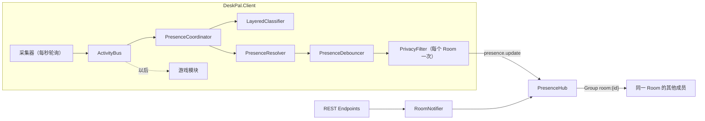

# DeskPal 架构

描述当前代码的实际情况。和原方案 [plan-v1.md](plan-v1.md) 不一致的地方，以本文和 [progress.md](progress.md) 的“偏离方案”为准。

## 组成

| 项目 | 目标框架 | 职责 |
|---|---|---|
| `DeskPal.Shared` | net10.0 | Envelope、消息类型常量、状态和类别枚举、REST DTO、Hub 契约。Server 和客户端都引用 |
| `DeskPal.Server` | net10.0 | ASP.NET Core：Auth、Rooms、Presence（SignalR Hub）、Rules；SQLite |
| `DeskPal.Client.Core` | net10.0 | 不依赖 Windows 的纯逻辑：事件总线、分类器、状态判断、防抖、隐私过滤 |
| `DeskPal.Client` | net10.0-windows10.0.19041.0 | WPF 托盘程序：采集器、Hub 连接、界面，输出文件 `DeskPal.exe` |
| `DeskPal.Tests` | net10.0 | xUnit：分类、状态、Room 生命周期、Hub 集成测试 |

## 数据流

1. 采集器把事实发布到 `ActivityBus`（基于 Channel 的一对多广播）。
2. `PresenceCoordinator` 把信号合并进 `ActivitySnapshot`，分类后得到 `LocalPresence`，交给防抖器。
3. 防抖器提交 `CommittedPresence` 以后，对用户加入的每个 Room 按该 Room 的隐私配置过滤一次，再分别发布。
4. Server 只检查发送者是否为 Room 成员，然后转发给同一 Group 的其他连接，并把最新状态缓存在内存里。

## 采集信号

| 信号 | 来源 | 说明 |
|---|---|---|
| `ForegroundSignal` | `GetForegroundWindow` + 进程信息 + `FileVersionInfo` | 进程名、友好名称、窗口标题、是否全屏、是否浏览器 |
| `BrowserDomainSignal` | UI Automation 读地址栏 | 只取 host，3 秒超时，切换标签后最多约 2 秒才更新 |
| `IdleSignal` | `GetLastInputInfo` | 超过 `IdleMinutes`（默认 5）无输入 |
| `LockSignal` | `SystemEvents.SessionSwitch` | 锁屏和解锁 |
| `MicSignal` | 注册表 `CapabilityAccessManager\ConsentStore\microphone` | `LastUsedTimeStop == 0` 表示正在占用 |
| `MediaSignal` | WinRT `GlobalSystemMediaTransportControlsSessionManager` | 是否在播放、标题、来源应用 |

## 分类

`LayeredClassifier` 按层匹配，命中即停止：个人规则 → Room 规则 → 内置规则 → 推测 → `Other`。

- 浏览器：先按域名（取最具体的后缀），再按标题关键词，最后按进程名。非浏览器只按进程名。
- 推测层只在前三层都没命中时生效：路径含 `\steamapps\` 的程序归为 `Game`；全屏且（前台是浏览器或正在播放媒体）归为 `Video`；正在播放媒体归为 `Music`。
- 个人规则保存在 `%APPDATA%\DeskPal\personal-rules.json`。用户点“这个判断不对”时，可以选只对自己生效，或者同步到当前 Room（写入 Room 规则）。
- 内置规则保存在 `builtin-rules.json`（目前版本 1，266 条），Server 启动时写入数据库；客户端启动时带上已缓存的版本号请求，版本相同就不返回规则。

## 状态判断和防抖

`PresenceResolver` 的优先级：暂停分享 → 手动状态（`Custom`）→ 锁屏 → 麦克风占用（`Meeting`）→ 空闲（`Away`，全屏播放视频时除外）→ 分类结果。

`PresenceDebouncer`：

- 新状态要持续 `StableSeconds`（默认 30 秒）才提交，`Since` 记为开始出现的时刻。
- 暂停分享、手动状态、锁屏，进入和退出都立即提交。
- 状态不变、只是详情变了（例如切换到另一个视频），按同样的间隔限频。

## 隐私

- 隐私级别按 Room 和类别分别配置：`StateOnly`（只显示状态）、`Category`（再加类别和应用名）、`Detail`（再加窗口标题或媒体标题）。
- 默认值：`Work`、`Meeting`、`Communication` 为 `StateOnly`，其他类别为 `Category`。没有人默认开启 `Detail`。
- 过滤在客户端完成，原始标题不经过 PrivacyFilter 就不会离开本机。
- Envelope 的 `Enc` 字段预留给端到端加密，Server 不解析 Payload。

## REST 接口

除注册、登录、`/health` 和内置规则外都要求 `Authorization: Bearer <token>`。错误返回 `{ "error": "中文说明" }`。

| 方法 | 路径 | 说明 |
|---|---|---|
| POST | `/api/auth/register` | 注册，返回 `AuthResponse`（含 token，有效期 30 天） |
| POST | `/api/auth/login` | 登录 |
| GET | `/api/me` | 当前用户 |
| GET | `/api/rooms` | 我加入的 Room |
| POST | `/api/rooms` | 创建 Room（每人最多拥有 `MaxOwnedRoomsPerUser` 个） |
| POST | `/api/rooms/{id}/invites` | 生成邀请码，旧邀请码失效，24 小时过期 |
| POST | `/api/rooms/join` | 用邀请码加入（人数上限 `MaxMembersPerRoom`） |
| POST | `/api/rooms/{id}/leave` | 退出；所有者退出返回 409 |
| POST | `/api/rooms/{id}/transfer` | 所有者转让所有权 |
| DELETE | `/api/rooms/{id}` | 所有者解散，级联删除成员、邀请码、Room 规则 |
| GET/PUT | `/api/rooms/{id}/privacy` | 我在该 Room 的隐私配置 |
| GET/PUT | `/api/rooms/{id}/rules` | Room 规则；PUT 按（种类，标准化后的内容）新增或覆盖 |
| GET | `/api/rules/builtin?version=N` | 内置规则；版本相同时 `rules` 为 null |
| GET | `/health` | 健康检查 |

## Hub

路径 `/hubs/presence`，token 通过查询参数 `access_token` 传递。客户端调用 `Publish(Envelope)`，接收 `Receive(Envelope)`。

| 类型 | 发送方 | Payload | 说明 |
|---|---|---|---|
| `presence.update` | 客户端 | `PresenceSnapshot` | Server 缓存最新一条；新连接会收到同 Room 其他人的缓存；最后一个连接断开时 Server 广播 `Offline` |
| `interaction.poke` | 客户端 | `PokePayload(Text, TargetUserId)` | 对方显示托盘气泡；对方离线时丢失 |
| `room.memberJoined` / `room.memberLeft` | Server | `RoomEventPayload(UserId)` | 同时增删 SignalR Group |
| `room.ownerChanged` | Server | `RoomEventPayload(新所有者)` | |
| `room.dissolved` | Server | `RoomEventPayload(null)` | 之后所有成员移出 Group |
| `rules.roomRulesChanged` | Server | `RoomEventPayload(修改人)` | 客户端重新拉取 Room 规则 |

## 数据模型（SQLite，本地 `storage/deskpal.db`，容器内 `/data/deskpal.db`）

| 表 | 主要字段 |
|---|---|
| `Users` | Id、UserName（唯一）、DisplayName、PasswordHash（PBKDF2）、CreatedAt |
| `Rooms` | Id、Name、OwnerId、MaxMembers、CreatedAt |
| `RoomMembers` | RoomId + UserId、Role、JoinedAt、PrivacyProfileJson（为空时用默认值） |
| `RoomInvites` | Code、RoomId、CreatedBy、ExpiresAt |
| `RoomRules` | RoomId、Kind、Pattern、Category、Name、CreatedBy、UpdatedAt |
| `BuiltinRules` / `AppMeta` | 内置规则和规则库版本号 |

实时状态、连接、在线情况只在内存里（`PresenceStore`、`ConnectionRegistry`），Server 重启后清空。

## 客户端本地文件（`%APPDATA%\DeskPal`）

| 文件 | 内容 |
|---|---|
| `settings.json` | Server 地址（默认 `https://deskpal.hafuhafu.cn:36443`）、当前用户、DPAPI 加密的 token、选中的 Room、空闲和防抖参数、暂停和手动状态 |
| `personal-rules.json` | 个人规则 |
| `builtin-rules.json` | 内置规则缓存 |

开机自启写入 `HKCU\Software\Microsoft\Windows\CurrentVersion\Run`；用命名 Mutex 保证单实例运行。

## 部署和发布

细节见 [deploy/README.md](../deploy/README.md)。

| 环节 | 做法 |
|---|---|
| Server 镜像 | `.github/workflows/docker.yml`：推送默认分支或 `v*` 标签时用 `deploy/Dockerfile.server` 构建，推到 `ghcr.io/hulushilei/deskpal-server` |
| Server 运行 | Portainer Stack（`deploy/stack.yml`），在 192.168.66.5 上发布 18820 端口；`Jwt__Key` 来自 Stack 环境变量 `DESKPAL_JWT_KEY` |
| HTTPS | 192.168.66.10 上已有的 Traefik：`deskpal.hafuhafu.cn` 走 443 和 36443 两个入口，`*.hafuhafu.cn` 泛域名证书（阿里云 DNS challenge）；路由文件 `/etc/traefik/conf/deskpal.yml`，仓库里的副本是 `deploy/traefik-dynamic.yml` |
| 客户端 | `.github/workflows/ci.yml`：在 Windows runner 上发布成自包含单文件 `DeskPal.exe`；每次推送上传 Actions artifact，`v*` 标签同时创建 GitHub Release |
