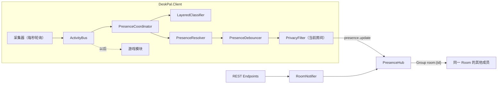

# DeskPal 架构

描述当前代码的实际情况。和原方案 [plan-v1.md](plan-v1.md) 不一致的地方，以本文和 [progress.md](progress.md) 的“偏离方案”为准。

## 组成

| 项目 | 目标框架 | 职责 |
|---|---|---|
| `DeskPal.Shared` | net10.0 | Envelope、消息类型常量、状态和类别枚举、REST DTO、Hub 契约。Server 和客户端都引用 |
| `DeskPal.Server` | net10.0 | ASP.NET Core：Auth、Rooms、Presence（SignalR Hub）、Rules；SQLite |
| `DeskPal.Client.Core` | net10.0 | 不依赖 Windows 的纯逻辑：事件总线、分类器、状态判断、防抖、隐私过滤、面板状态（`Ui/PanelStateBuilder`） |
| `DeskPal.Client` | net10.0-windows10.0.19041.0 | WPF 托盘程序：采集器、Hub 连接、WebView2 宿主窗口，输出文件 `DeskPal.exe`。`web/` 是面板和登录页的前端（Vite + TypeScript + Preact），构建结果复制到输出目录的 `web/` |
| `DeskPal.Tests` | net10.0 | xUnit：分类、状态、Room 生命周期、Hub 集成测试 |

## 数据流

1. 采集器把事实发布到 `ActivityBus`（基于 Channel 的一对多广播）。
2. `PresenceCoordinator` 把信号合并进 `ActivitySnapshot`，分类后得到 `LocalPresence`，交给防抖器。
3. 防抖器提交 `CommittedPresence` 以后，只按当前进入的房间做隐私过滤并发布。切换房间时，先给上一个房间发离线，再给当前房间发状态。已加入但没进入的房间留在列表里，再次进入不用邀请码。选「无房间」（`AppSettings.NoRoom`，或一个房间都没有）时 `RoomState.SelectedRoom` 为 null，所有房间都收到离线，之后不发布状态；选择、创建或加入房间时清除。分类和房间无关，切换房间不改变分类结果。
4. Server 只检查发送者是否为该房间的成员，然后转发给同一 Group 的其他连接，并把最新状态缓存在内存里。

## 采集信号

| 信号 | 来源 | 说明 |
|---|---|---|
| `ForegroundSignal` | `GetForegroundWindow` + 进程信息 + `FileVersionInfo` | 进程名、友好名称、窗口标题、是否全屏、是否浏览器 |
| `BrowserDomainSignal` | UI Automation 读地址栏 | 只取 host，3 秒超时，切换标签后最多约 2 秒才更新 |
| `IdleSignal` | `GetLastInputInfo` | 超过 `IdleMinutes`（默认 5）无输入 |
| `LockSignal` | `SystemEvents.SessionSwitch` | 锁屏和解锁 |
| `MediaSignal` | WinRT `GlobalSystemMediaTransportControlsSessionManager` | 是否在播放、标题、来源应用 |

## 分类

`LayeredClassifier` 按层匹配，命中即停止。

- 前台是浏览器：先查个人分类，没有命中时归为 `Browsing`，应用名用域名（没有域名则为空），详情用去掉浏览器后缀的窗口标题。不使用内置的网站和标题规则，也不因为全屏或正在播放而归成视频。个人分类里先按域名（取最具体的后缀），再按标题关键词，最后按进程名。`Shopping`、`Social`、`News`、`Reading` 的规则跳过，结果仍是正在浏览网页。
- 其他应用：个人分类 → 内置规则 → 推测 → `Other`，只按进程名匹配。
- 推测层只对非浏览器、且前几层都没命中时生效：路径含 `\steamapps\` 的程序归为 `Game`；全屏且正在播放媒体归为 `Video`。正在播放媒体本身不分类，避免后台音乐盖过当前焦点。

### 个人分类

- 「纠正分类」和「待归类」写入个人分类（`PUT /api/me/rules`），按账号保存在 Server 的 `UserRules` 表，所有房间、所有电脑通用，只影响自己的识别结果。没有房间规则：同一个应用，房间里每个人可以有不同的分类。
- 识别结果照常经过隐私过滤后广播，所以别人看到的是你自己的分类，例如“工作中 · 微信”。新加入的房间所有类别默认只显示状态，要在该房间把工作改成“显示类别和应用”，别人才看得到应用名。
- 修改后 Server 只给该用户自己的连接发 `rules.personalChanged`，各台电脑重新拉取。客户端在 `%APPDATA%\DeskPal\personal-rules.json` 缓存一份（带 userId，换账号时不用别人的缓存），离线启动时先用缓存。
- 每人最多 500 条；`Meeting` 和退役类别不能设置。「分类」页的「我的分类」可以搜索、修改和删除，状态页对当前应用提供「恢复默认」。

### 未识别应用和规则库候选

- `UnclassifiedUsage` 在内存里统计当天每个未识别桌面应用（落到 `Other` 层）的前台时长：两次记录间隔超过 30 秒的不计，本地零点清零。浏览器网页不统计。状态页的「待归类」列出今天用了 5 分钟以上的前 5 个。
- 第一次打开面板时询问是否分享使用数据（`Users.ShareUsage`，空表示还没问过），设置页可以随时改。关闭时删除已上报的数据。
- 同意分享时，`UsageReporter` 每 2 小时上报今天用了 10 分钟以上的未识别应用（进程名、产品名、分钟数，`POST /api/me/usage`），不含窗口标题、网页和具体时间。
- `GET /api/rules/candidates` 只统计同意分享、注册满 `Rules:MinAccountAgeDays`（默认 3）天的账号，一个账号一票：
  - 多人一致：至少 `Rules:MinUsers`（默认 5）个账号设置过同一个应用，占比最高的类别不低于 `Rules:MinAgreement`（默认 0.8），且和内置规则不同。
  - 未识别应用：至少 `MinUsers` 个账号上报过，内置规则和任何人的个人分类都没有覆盖。
- 该接口要求请求头 `X-DeskPal-Maintainer` 等于 `Rules:MaintainerToken`，口令为空时返回 404。`.github/workflows/rule-candidates.yml` 每周请求一次，把多人一致的结果写进 `builtin-rules.json` 并开 PR，未识别应用列在 PR 说明里，人工审核后合并。
- 内置规则保存在 `builtin-rules.json`（目前版本 3，190 条），Server 启动时写入数据库；客户端启动时带上已缓存的版本号请求，版本相同就不返回规则。里面的网站和标题规则不参与浏览器的默认分类。版本 3 起没有 `Music`、`Shopping`、`Social`、`News`、`Reading`。
- 分类口径：桌面应用里，企业微信、飞书、钉钉、Slack、Teams、邮箱和会议软件归为 `Work`；QQ、微信、Telegram 等个人聊天归为 `Communication`。浏览器里的网页不再按网站种类细分。音乐播放器、Kindle、calibre、Discord 没有单独类别，显示为“正在使用 XX”。

## 状态判断和防抖

`PresenceResolver` 的优先级：暂停分享 → 锁屏 → 空闲（`Away`，全屏播放视频时除外）→ 分类结果。

`PresenceDebouncer`：

- 新状态要持续 `StableSeconds`（10 秒，不写入 `settings.json`）才提交，`Since` 记为开始出现的时刻。`PresenceCoordinator` 在到期时刻再判定一次，不等下一次 5 秒的定时判定。
- 状态页「我的状态」大字显示已提交的状态，按当前房间的隐私设置过滤，和房间成员看到的一致；鼠标指向状态、应用名、标题时，用气泡显示不经过滤的类别、应用和标题（`PanelState.me.full`），只给自己看，不上报。无房间时不过滤。有待提交的新状态时，标题行右侧显示「n 秒后变为」和新状态（同样过滤），标题行不足 300px 时缩成「n 秒 →」，仍是一行；进度条贴在卡片底边，不改变卡片高度；`PanelState.me.pending` 给出剩余毫秒，页面自己倒数，指向倒计时显示新状态的完整内容（`pending.full`）和识别方式。房间成员还没有收到过状态时，右上角不显示文字。只有详情变了的，直接显示本机的新详情，不显示倒计时。
- 暂停分享、锁屏，进入和退出都立即提交。
- 状态不变、只是详情变了（例如切换到另一个视频），按同样的间隔限频。

不采集麦克风，也不再产生 `Meeting`。`Meeting` 留在 `PresenceState` 和 `ActivityCategory` 里，收到时显示为“工作中”。

## 界面文案

`PresenceFormatter.Format` 把状态拆成三行：标题（工作中、在聊天、正在浏览网页、正在使用 XX、在看视频、在放松、暂离、已锁屏等）、应用名、详情。浏览器的应用名是域名，详情是页面标题；页面上标题一行，应用名和详情合成一行（“应用 · 详情”），只有其中一个就显示那一个。应用名和详情去掉首尾空白后相同（不区分大小写）时，详情不再显示，避免出现“QQ · QQ”。`Tone`（work、chat、relax、browse、other、away、offline）决定标题颜色和头像上的状态点。详情超过 36 个字时在界面上截断并加“…”，共享出去的 `Detail` 不截断。文案用书面用语，不用“忙”“摸鱼”。

## 界面

托盘图标和托盘菜单是 WPF 原生的。面板和登录页是 HTML，放在标准 `WebView2` 控件里：

| 窗口 | 文件 | 内容 |
|---|---|---|
| 面板 | `Ui/PanelWindow.cs`、`Ui/PanelBridge.cs` | 标题栏中间是房间切换菜单。左侧导航四页：状态（我的状态、房间成员、待归类）、房间（列表、创建和加入、改名、邀请码、屏蔽成员、转让、退出、解散、隐私设置）、分类（我的分类，可按应用、网站、类别搜索，修改和删除）、设置（账号和退出登录、开机自启、窗口置顶、关闭窗口时、夜间模式、分享使用数据、测试版、检查更新、问题与建议）。默认 420×680，可以拖动边框调整，最小 400×480，不能最大化；内容最宽 640px 居中。第一次打开时停靠在屏幕右下角。关闭按钮默认弹出选择：最小化，或最小化到系统托盘，可勾选不再提示；设置里可以改成每次询问、最小化或最小化到系统托盘。托盘菜单只有「打开 DeskPal」和「退出」 |
| 登录 | `Ui/LoginWindow.cs` | 登录和注册。在 Room、Hub 等服务启动之前显示，所以是单独的窗口 |
| 置顶小卡片 | `Ui/MemberCards.cs`、`Ui/MemberCardWindow.cs`、`PinnedMembers`（Client.Core） | 状态页成员行的大头针把该成员置顶到桌面，每人一张 280×84 的卡片（`index.html?page=card`），人数不限。卡片总在最前，不显示在任务栏，不抢焦点；从屏幕右上角往下排，整张可以拖动，双击打开面板，点 × 取消置顶。内容是头像、名字、已持续多久、状态标签，应用名和详情合成一行（C# 算好放在 `card` 消息里）。置顶只存在内存里，属于置顶时所在的房间：切换房间、选「无房间」、该成员退出、被踢出或被我屏蔽时移除，再进入也不恢复，重启后也没有 |

外观按 Windows 11 桌面程序做，不像网页：

- 没有系统标题栏。`Ui/WindowFrame.cs` 用 `WindowChrome`（`CaptionHeight` 0、`GlassFrameThickness` 0）去掉标题栏但保留窗口边框，并通过 DWM 要求圆角，Windows 11 上仍有圆角和阴影。
- 标题栏画在页面里（`TitleBar`）：CSS `app-region: drag` 的区域可以拖动窗口，依赖 WebView2 的 `IsNonClientRegionSupportEnabled`；最小化按钮发 `window.minimize`。面板的关闭按钮按 `CloseAction` 处理：`ask` 先在页面里选择，`minimize` 发 `window.minimize`，`tray` 发 `window.close`（面板只隐藏，不退出）。登录窗口的关闭直接发 `window.close`。
- 颜色默认跟随系统的浅色、深色模式。设置里的「夜间模式」可以改成固定浅色或固定深色，选择记在 `settings.json`。WPF 窗口背景使用同一次选择；跟随系统时仍读注册表 `AppsUseLightTheme`，避免加载时闪白。图标用 Segoe Fluent Icons；开关、设置行、菜单、对话框按 Windows 11 的控件样式写。
- 页面不能选中文字（输入框和 `.selectable` 除外），不显示手形光标，只在键盘操作时显示焦点框；关闭了缩放、滑动导航、自动填充和保存密码。
- 没有 WebView2 Runtime 时，面板退回一个 WPF 提示窗口，可以拖动和关闭。

- 前端从安装目录的 `web/` 加载，虚拟主机名 `app.deskpal.example`，不开本地端口。跳到其他来源的链接用系统浏览器打开。
- WebView2 用户数据目录：安装版是 `<安装目录>\WebView2`，直接运行时是 `%LOCALAPPDATA%\DeskPal\WebView2`。不放在 Velopack 每次更新都会替换的 `current\` 下。
- 面板隐藏 5 分钟后释放 WebView2，它的进程随之退出；再打开时重新加载，约 0.5 秒。
- 更新的确认和提示（`UpdateInteraction`）通过 `IUserPrompt` 显示在面板里；面板不可用时退回系统对话框。手动检查一点击，设置页就显示「正在检查更新…」，按钮变为「请稍候…」；开始下载后改为「正在下载新版本 x（百分比）」。检查更新不弹出 Windows 通知气泡。后台每 6 小时的检查不显示这些过程，下载完成后设置页的「立即重启并更新」变为可用。
- 更新内容：根目录 `CHANGELOG.md` 随客户端复制到程序目录。启动时 `WhatsNewStore`（Client.Core）把它和 `%APPDATA%\DeskPal\changelog-seen.json` 里看过的条目比较，有新条目就放进 `PanelState.whatsNew`，页面弹出「已更新到 x」和按版本分组的列表；点「知道了」发 `changelog.seen`，记下当前版本和全部条目。没有记录时（首次安装、第一次升级到有这个功能的版本）只记录不弹出。
- 启动时检测 WebView2 Runtime。没有时用系统对话框提示下载：已登录时采集和同步照常，只是面板打不开；未登录时无法登录。

宿主和页面之间用 JSON 消息通信（`PostWebMessageAsJson` / `chrome.webview.postMessage`），类型定义在 `web/src/bridge.ts`：

| 方向 | 消息 |
|---|---|
| 宿主 → 页面 | `state`（完整的 `PanelState`，变化后最多每 200 毫秒推一次）、`result{id, ok, error, data}`、`dialog{id, kind, message}`、`login{serverUrl, userName}` |
| 页面 → 宿主，要回复 | `{id, type, ...}`：`room.*`、`presence.pause / correct / resetCorrection`、`rules.set / delete`、`settings.autoStart / topmost / shareUsage`、`update.check / beta / restart`、`changelog.seen`、`auth.login / register / logout` |
| 页面 → 宿主，不回复 | `ready`、`dialog.answer{dialogId, ok}`、`window.minimize`、`window.close` |

`PanelState` 由 `PanelStateBuilder` 在 Client.Core 里生成，界面上的文字（连接状态、空提示、识别方式（悬停问号显示）、待提交状态、我的分类、待归类）都在 C# 里算好。状态页不显示「房间成员看到」，页面只负责显示。页面写「房间」，不写 Room。`PanelFixtureTests` 把几组样例序列化到 `web/src/mock/fixtures/`，不一致就失败，改了 `PanelState` 或文案后用 `DESKPAL_UPDATE_FIXTURES=1` 运行测试更新。

在浏览器里调试：`cd src/DeskPal.Client/web; npm run dev`，打开 `http://localhost:5190/`。没有 `chrome.webview` 时页面用模拟宿主，参数 `?mock=default|no-room|guest` 切换样例，`?fail` 让所有命令失败，`?page=login` 打开登录页，发出的命令记录在 `window.__sent`。Debug 版客户端设置环境变量 `DESKPAL_UI_URL=http://localhost:5190/` 可以直接加载开发服务器。

## 隐私

- 隐私级别按 Room 和类别分别配置：`StateOnly`（只显示状态）、`Category`（再加类别和应用名）、`Detail`（再加窗口标题或媒体标题）。创建或加入房间时，Server 把所有类别写成 `StateOnly`。
- 默认值：`Work`、`Meeting`、`Communication` 为 `StateOnly`，其他类别为 `Category`。没有人默认开启 `Detail`。
- 过滤在客户端完成，原始标题不经过 PrivacyFilter 就不会离开本机。
- Envelope 的 `Enc` 字段预留给端到端加密，Server 不解析 Payload。

## REST 接口

除注册、登录、`/health`、内置规则和规则库候选外都要求 `Authorization: Bearer <token>`。错误返回 `{ "error": "中文说明" }`。

| 方法 | 路径 | 说明 |
|---|---|---|
| POST | `/api/auth/register` | 注册，返回 `AuthResponse`（含 token，有效期 30 天） |
| POST | `/api/auth/login` | 登录。同一账号同一时间只能在一台电脑上登录：每次登录（和注册）生成新的 `Users.SessionId` 并写进 token（`sid`），之前登录的电脑收到 `auth.sessionReplaced`，2 秒后断开，它的旧 token 之后一律返回 401。部署前发出、不带 `sid` 的 token 在该账号下次登录前仍然有效 |
| GET | `/api/me` | 当前用户，含 `shareUsage`（空表示还没问过） |
| PUT | `/api/me/displayName` | 修改名称（`UpdateDisplayNameRequest`，去掉首尾空格后 1 到 20 个字符，允许重名）；名称有变化时给该用户所在的每个 Room 广播 `room.memberRenamed`，没有 Room 时只发给自己的连接 |
| GET | `/api/me/rules` | 我的个人分类，最近修改的在前 |
| PUT | `/api/me/rules` | 按（种类，标准化后的内容）新增或覆盖个人分类（`UpsertUserRuleRequest`），之后给自己的连接发 `rules.personalChanged` |
| DELETE | `/api/me/rules?kind=&pattern=` | 删除一条个人分类，返回 204 |
| PUT | `/api/me/sharing` | 是否分享使用数据（`SetSharingRequest`）；关闭时删除已上报的未识别应用 |
| POST | `/api/me/usage` | 上报今天的未识别应用（`UsageReportRequest`，最多 50 个，只收应用）。没有同意分享时返回 403 |
| GET | `/api/rooms` | 我加入的 Room。`blocked` 只列出我自己屏蔽的、仍在房间里的成员，不会出现别人的屏蔽记录 |
| POST | `/api/rooms` | 创建 Room（每人最多拥有 `MaxOwnedRoomsPerUser` 个） |
| POST | `/api/rooms/{id}/invites` | 生成邀请码，旧邀请码失效，24 小时过期。同时删除踢出记录，被踢出的人可以用新邀请码加入 |
| POST | `/api/rooms/join` | 用邀请码加入（人数上限 `MaxMembersPerRoom`，默认 20）。被踢出且邀请码尚未更新时返回 403 |
| POST | `/api/rooms/{id}/leave` | 退出；所有者退出返回 409。退出后可以用邀请码再次加入 |
| POST | `/api/rooms/{id}/kick` | 所有者踢出成员（`KickMemberRequest`）。对方从房间列表消失。生成新邀请码后可以再加入 |
| POST | `/api/rooms/{id}/blocks` | 屏蔽一名成员（`BlockMemberRequest`），返回 204。双向生效：我不再向对方发状态，也不再收到对方的状态。对方收到一条我的 `Offline`，看不出被屏蔽。屏蔽记录在退出后再加入时仍然有效 |
| DELETE | `/api/rooms/{id}/blocks/{userId}` | 取消屏蔽，返回 204。双方互相补发最新状态（对方也屏蔽了我时不补发） |
| POST | `/api/rooms/{id}/transfer` | 所有者转让所有权 |
| PUT | `/api/rooms/{id}` | 所有者修改 Room 名称（`RenameRoomRequest`，去掉首尾空格后 1 到 30 个字符）；名称有变化时广播 `room.renamed` |
| DELETE | `/api/rooms/{id}` | 所有者解散，级联删除成员、邀请码、踢出记录和屏蔽记录 |
| GET/PUT | `/api/rooms/{id}/privacy` | 我在该 Room 的隐私配置 |
| GET | `/api/rules/builtin?version=N` | 内置规则；版本相同时 `rules` 为 null |
| GET | `/api/rules/candidates` | 规则库候选（`RuleCandidatesResponse`），请求头 `X-DeskPal-Maintainer` 要等于 `Rules:MaintainerToken`，否则 404 |
| GET | `/health` | 健康检查，返回 `status` 和 `revision`（镜像构建时的 Git 提交号，本地运行为空） |

## Hub

路径 `/hubs/presence`，token 通过查询参数 `access_token` 传递。客户端调用 `Publish(Envelope)`，接收 `Receive(Envelope)`。

| 类型 | 发送方 | Payload | 说明 |
|---|---|---|---|
| `presence.update` | 客户端 | `PresenceSnapshot` | 客户端只向当前进入的房间发布，切换时向上一个房间发离线。Server 缓存最新一条；新连接会收到同房间其他人的缓存；最后一个连接断开时，Server 向该用户加入的每个房间广播 `Offline`。转发、补发缓存和离线广播都跳过与发送方互相屏蔽的成员（任一方屏蔽了另一方） |
| `room.memberJoined` / `room.memberLeft` | Server | `RoomEventPayload(UserId)` | 同时增删 SignalR Group |
| `room.kicked` | Server | `RoomEventPayload(被踢出的人)` | 只发给被踢出的人。客户端提示邀请码更新后才能再次加入，并重新拉取房间列表 |
| `room.blocksChanged` | Server | `RoomEventPayload(被屏蔽的人)` | 只发给屏蔽者本人的所有连接，客户端重新拉取房间列表。被屏蔽的人不会收到任何房间事件 |
| `room.ownerChanged` | Server | `RoomEventPayload(新所有者)` | |
| `room.renamed` | Server | `RoomEventPayload(null)` | 客户端重新拉取 Room 列表 |
| `room.memberRenamed` | Server | `RoomEventPayload(userId)` | 成员改了显示名称。客户端重新拉取 Room 列表；是自己时（另一台电脑改的）先用 `/api/me` 更新本机保存的显示名称 |
| `room.dissolved` | Server | `RoomEventPayload(null)` | 之后所有成员移出 Group |
| `rules.personalChanged` | Server | `RoomEventPayload(本人)` | 只发给本人的所有连接，`RoomId` 为空 Guid。客户端重新拉取个人分类 |
| `auth.sessionReplaced` | Server | `RoomEventPayload(本人)` | 账号在另一台电脑登录。只发给之前登录的电脑，`RoomId` 为空 Guid，2 秒后 Server 断开这些连接。客户端清除 token，重启到登录页，提示「账号已在其他电脑登录，请重新登录。」没收到这条消息的（当时离线），之后重连或调用接口得到 401 时同样处理 |

## 数据模型（SQLite，本地 `storage/deskpal.db`，容器内 `/data/deskpal.db`）

| 表 | 主要字段 |
|---|---|
| `Users` | Id、UserName（唯一）、DisplayName、PasswordHash（PBKDF2）、CreatedAt、ShareUsage（空表示还没问过）、SessionId（当前登录的会话，空表示升级后还没登录过） |
| `Rooms` | Id、Name、OwnerId、MaxMembers、CreatedAt |
| `RoomMembers` | RoomId + UserId、Role、JoinedAt、PrivacyProfileJson（为空时用默认值） |
| `RoomInvites` | Code、RoomId、CreatedBy、ExpiresAt |
| `RoomBans` | RoomId + UserId、BannedBy、BannedAt。生成新邀请码时删除，被踢出的人即可用新邀请码加入 |
| `RoomBlocks` | RoomId + BlockerId + BlockedId、CreatedAt。成员之间的屏蔽，退出房间后保留，解散房间时级联删除 |
| `UserRules` | UserId + Kind + Pattern（唯一）、Category、Name、UpdatedAt。个人分类 |
| `UnknownAppReports` | UserId + Kind + Pattern、DisplayName、Minutes（最近一次上报的当天分钟数）、ReportedAt |
| `BuiltinRules` / `AppMeta` | 内置规则和规则库版本号 |

Server 启动时自动执行还没应用的迁移，部署不需要手动删除或重建数据库。

实时状态、连接、在线情况只在内存里（`PresenceStore`、`ConnectionRegistry`），Server 重启后清空。

## 客户端本地文件

设置和规则在 `%APPDATA%\DeskPal`，卸载不会删除。日志和 WebView2 缓存在安装目录（Velopack 的根目录，`current\` 的上一级）：自动更新时保留，卸载或在同一目录重新安装时随目录一起清空（安装向导会先保留 `logs\`）。直接运行或安装目录不可写时，日志回到 `%APPDATA%\DeskPal\logs`，缓存回到 `%LOCALAPPDATA%\DeskPal\WebView2`，见 `Services/AppPaths.cs`。以前版本写在 `%APPDATA%\DeskPal\logs` 的旧日志不迁移。

| 文件 | 内容 |
|---|---|
| `settings.json` | Server 地址（默认 `https://deskpal.hafuhafu.cn:36443`）、当前用户、DPAPI 加密的 token、选中的 Room、是否为无房间（`noRoom`）、空闲和防抖参数、暂停分享、是否加入测试版（`includePrerelease`，空则沿用安装渠道）、是否分享使用数据（`shareUsage`，以 Server 为准）、关闭按钮（`closeAction`：`ask`、`minimize`、`tray`） |
| `personal-rules.json` | 个人分类的缓存（`userId` + `rules`），以 Server 为准 |
| `builtin-rules.json` | 内置规则缓存 |
| `<安装目录>\logs\deskpal.log` | 客户端运行日志。超过 1 MB 后改名为 `deskpal-时间.log`，最多保留 5 个旧文件，超过 7 天的旧文件删除。不记录窗口标题、媒体标题、域名、页面标题、密码、token、邀请码 |
| `<安装目录>\logs\setup.log` | 最近一次通过安装向导安装时 Velopack Setup.exe 的日志 |

`settings.json` 里还有窗口置顶（`topmost`）。WebView2 的缓存在 `<安装目录>\WebView2`。开机自启写入 `HKCU\Software\Microsoft\Windows\CurrentVersion\Run`；用命名 Mutex 保证单实例运行。

## 部署和发布

细节见 [deploy/README.md](../deploy/README.md)。

| 环节 | 做法 |
|---|---|
| Server 镜像 | `.github/workflows/docker.yml`：推送默认分支或 `v*` 标签时用 `deploy/Dockerfile.server` 构建，推到 `ghcr.io/hulushilei/deskpal-server` |
| Server 运行 | Portainer Stack（`deploy/stack.yml`），在 192.168.66.5 上发布 18820 端口；`Jwt__Key` 来自 Stack 环境变量 `DESKPAL_JWT_KEY`，`Rules__MaintainerToken` 来自可选的 `DESKPAL_MAINTAINER_TOKEN` |
| 规则库候选 | `.github/workflows/rule-candidates.yml`：每周一和手动运行，用 secret `DESKPAL_MAINTAINER_TOKEN` 请求 `/api/rules/candidates`，`.github/scripts/merge-rule-candidates.mjs` 合并进 `builtin-rules.json`，校验后开 PR（分支 `rules/candidates`） |
| 自动更新 | main 上的镜像同时推 `latest` 和 `sha-<提交号>`。GitHub Actions POST `PORTAINER_WEBHOOK_URL?tag=sha-<提交号>`，再等到 `/health` 的 `revision` 等于该提交号。Traefik 只在 36443 上公开 webhook token 路径 |
| HTTPS | 192.168.66.10 上已有的 Traefik：`deskpal.hafuhafu.cn` 走 443 和 36443 两个入口，`*.hafuhafu.cn` 泛域名证书（阿里云 DNS challenge）；路由文件 `/etc/traefik/conf/deskpal.yml`，仓库里的副本是 `deploy/traefik-dynamic.yml` |
| 客户端 | `.github/workflows/ci.yml`：main 上改了客户端时用 Velopack 发测试版 Pre-release（通道 `beta`，版本 `x.y.z-dev.<运行号>`，安装包 `DeskPal-<版本>-Setup.exe`，测试版版本号形如 `0.1.2-dev.15`），只保留最近 8 个；手动推送 `vX.Y.Z` 发正式版（通道 `win`，安装包同样是 `DeskPal-<版本>-Setup.exe`，例如 `DeskPal-0.1.2-Setup.exe`）。安装包是 Inno Setup 向导（`installer/DeskPal.iss`，CI 下载 Inno Setup 6.7.3 并校验 SHA256 后编译），内嵌 `vpk pack` 生成的 Setup.exe；用户选好目录后用 `--installto` 静默安装。Release 上只放这个向导，Velopack 自带的 Setup.exe 上传后删除，自动更新只用 nupkg 和 releases 清单。已安装的客户端启动后和每 6 小时向 GitHub Release 检查更新，后台下载；只在退出或选择立即重启时安装，启动时不自动安装。取消测试版会删除已下载的包。打包时带 `--framework webview2`，安装程序和每次更新前都会检查 WebView2 Runtime，缺少时自动安装。CI 先用 Node 22 构建 `web/`。Release 说明附带更新内容：测试版列出上一次发布以来的提交标题，正式版列出上一个正式版以来的提交标题。客户端弹出的更新内容另取自 `CHANGELOG.md`，CI 发布时要求最上面一节是本次的正式版版本号（测试版取 `x.y.z-dev.N` 的 `x.y.z`） |
