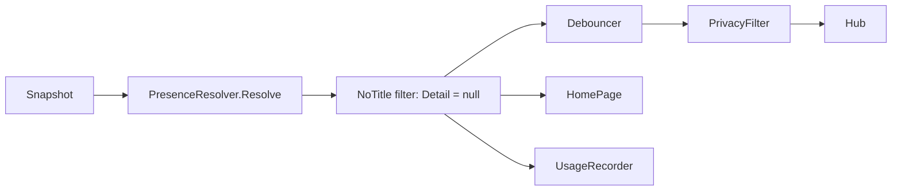

# 个人数据与不记录标题

## 做什么

1. 「不记录标题」规则命中时，房间实时状态、首页自己的状态和使用统计都不带标题，只保留状态、类别和应用名（网页保留域名）。现在房间里能看到向日葵的标题，就是因为实时状态完全没有用这些规则。
2. 导航里的「分类」改名为「规则」（英文 Rules），图标换成 `Filter`（`\uE71C`）。页面顶部放一个和统计页一样的 `segmented` 切换：「分类」（现有的待归类和我的分类）和「不记录标题」（列表行样式，和我的分类一致：种类图标、内容、删除按钮，右上角是添加）。统计页里删掉「不记录标题」这一行。两套列表放进同一个页面不会显得别扭，所以不单独加导航按钮。
3. 设置里新增「个人数据」一节，范围是个人分类、不记录标题和偏好设置（切换等待、外观、语言、关闭窗口时、窗口置顶、成员排序、暂离时长）。这一节有三行：
   - 「同步到账号」开关，新账号默认关闭。开启时弹出警告：这些数据会明文保存到服务器，包括不记录标题里的应用名、网址和关键词；关闭时立即删除服务器上的副本，本机保留。
   - 「同步文件夹」：选择文件夹或停止，可以和统计的同步文件夹选同一个。和「同步到账号」只能开启一种。
   - 「导入」「导出」：一个 JSON 文件。

## 口径

- **本机为准**：个人数据保存在 `%APPDATA%\DeskPal\personal\<userId>.json`，按账号区分。开启同步到账号时，本机修改同时提交到 Server，收到 `rules.personalChanged` 时用 Server 的数据覆盖本机。关闭时只读写本机。
- **已有账号**（用户选择）：迁移时，Server 上已有个人分类、偏好或暂离时长的账号设为已开启，新账号默认关闭。用户关闭时，Server 删除这个账号的 UserRules、UserNoTitleRules、Preferences 和 IdleMinutes，并通知这个账号的其他连接。其他电脑收到通知后转为只用本机数据，本机的数据保留。
- **开启时合并**：客户端把本机全部数据交给 Server。个人分类和不记录标题按（种类，内容）合并，修改时间较新的保留；偏好以账号已有的为准，账号缺少的字段用本机值。Server 返回合并结果，客户端用它覆盖本机。
- **开关关闭时 Server 的行为**：`GET /api/me/rules` 返回空列表；写个人分类、不记录标题、偏好、暂离时长的请求返回 403 `personalSync.off`；`AuthResponse.Preferences` 和 `IdleMinutes` 返回 null。
- **规则库候选**（用户选择）：开关关闭、但同意了「分享未识别应用」的账号，在现有的使用上报里附带自己的进程类个人分类（进程名、类别、名称），每次上报整份替换。Server 存进新表 `SharedRuleReports`，候选统计时和已开启同步的账号的 UserRules 合在一起，每个账号算一票。关闭分享或开启同步时，删除这个账号的 `SharedRuleReports`。
- **同步文件夹**：文件放在 `<文件夹>\DeskPal\<userId>\personal\<deviceId>.json`。统计的同步文件夹只读取名字是 Guid 的子目录，所以两者放在同一个文件夹里不会冲突。文件内容是明文，和导出文件、服务器上的副本一致；如果你希望加密，可以改成复用统计同步文件夹的 PIN 码。每台电脑只写自己的文件，其中包含删除标记（保留 90 天）。读取其他电脑的文件时，每条规则按修改时间较新的为准，偏好整份按较新的为准。本机有修改时立即写入，启动时和之后每 2 分钟读取一次。停止时不删除文件夹里的文件，退出登录时停止。
- **导入**：合并到本机。同一条规则以文件里的为准，偏好整份覆盖，不删除本机已有、文件里没有的规则。开启了同步到账号时，导入后提交到 Server。
- **过滤位置**：在 `PresenceCoordinator.Evaluate` 里，`PresenceResolver.Resolve` 之后立即按规则去掉 `Detail`，后面的防抖、`PrivacyFilter.Apply`、首页和 `UsageRecorder` 拿到的都是已经去掉标题的状态。匹配方式沿用现有的 `NoTitleRule.Matches`（应用名、进程名、域名含子域名、标题关键词）。即使隐私级别是「显示详情」，命中的状态也不带标题。

## 改哪里

- Shared：把 `NoTitleKind` 和规范化逻辑（`NoTitleRule.Create`）移到 `DeskPal.Shared/Api`，Server 也要用它校验。新增 `NoTitleRuleDto`、`PersonalDataDto`（规则、不记录标题、偏好、暂离时长）、`PersonalSyncStatus`，在 `AuthResponse` 末尾加上 `PersonalSync`，在 `UsageReportRequest` 加上 `Rules`，在 `ApiErrorCodes` 加上 `personalSync.off`。
- Server 数据库（按 `deskpal-db-change`）：`Users.PersonalSync`，新表 `UserNoTitleRules` 和 `SharedRuleReports`。迁移 `AddPersonalSync` 用 SQL 给已有数据的账号设为 true。
- Server `Features/Rules`：`UserRuleService` 和 `/api/me/preferences`、`/api/me/idle` 检查开关；新增 `NoTitleRuleService` 和对应的 Endpoints（列出、新增或修改、删除）；新增 `PersonalSyncService`，提供 `POST /api/me/personal-sync`（开启并合并，返回合并结果）和 `DELETE /api/me/personal-sync`（关闭并删除）。`RuleCandidateService` 要统计 `SharedRuleReports`，上报时写入这张表。
- Client.Core：新增 `Personal/`，包含 `PersonalDataStore`（本机文件，按账号区分）、`PersonalMerge`（按修改时间合并，带删除标记）、`PersonalFolderSync`（同步文件夹）和 `TitleFilter`。`NoTitleRule` 从 `Usage/` 移到这里。`PersonalRuleStore` 从缓存改成由 `PersonalDataStore` 取代。`UsageRecorder` 去掉不记录标题的判断，只保留「标题等于应用名就不记」。`StatsSync` 不再读写 `SyncedStatsSettings`。
- 客户端 Services：`PersonalRules` 改成本机优先，开关开启时才调用 API；新增 `PersonalDataService`，负责开关、导入导出和同步文件夹；`PreferencesSync`、`IdleSync` 在开关关闭时跳过；`PresenceCoordinator` 调用 `TitleFilter`；`StatsSyncService` 删掉 `Read`/`Apply` 设置的部分；`AppSettings.NoTitleRules` 在第一次启动时迁移到个人数据文件后删除；新增 `PreferencesUpdatedAt`，供同步文件夹合并用；使用上报附带个人分类。
- `PanelState`/`PanelStateBuilder`：`NoTitleRules` 从 `UsageView` 移到顶层；`SettingsView` 增加 `personalSync`（是否开启、同步文件夹路径、文件夹是否可用、错误）。
- `PanelBridge`：命令 `stats.noTitle.*` 改名为 `noTitle.add`、`noTitle.remove`；新增 `personal.sync.enable`、`personal.sync.disable`、`personal.folder.choose`、`personal.folder.enable`、`personal.folder.stop`、`personal.export`、`personal.import`。
- 页面：`App.tsx`（导航名称和图标）、`RulesPage.tsx`（切换和不记录标题列表）、`StatsPage.tsx`（删除不记录标题这一行和 `sync.noTitleSynced`）、`SettingsPage.tsx`（个人数据一节）、`ui.tsx`（`filter` 图标）、`bridge.ts`、`mockHost.ts`、fixtures（用 `DESKPAL_UPDATE_FIXTURES=1` 生成）。
- 文案（按 `deskpal-ui-copy`，中英文都写）：`web/src/i18n/zh-CN.ts`、`en.ts`、`Strings*.resx`，包括新错误码 `ApiError_personalSync_off`。
- 测试：TitleFilter（各种规则命中后实时状态和统计都没有标题）、PersonalMerge（删除标记、按修改时间合并）、PersonalFolderSync（两台电脑共用一个临时目录，并和统计同步文件夹共存）、Server 集成测试（开关、关闭时删除数据、开关关闭时返回 403、迁移设开启、候选统计 `SharedRuleReports`）。
- 文档：`AGENTS.md` 硬约束第 4 条、`.cursor/rules/server.mdc`（候选口径）、`client-core.mdc`（个人分类按账号这一条）、`docs/architecture.md`、`docs/progress.md`（已定和变更日志）、`docs/known-issues.md`、`CHANGELOG.md`。plan 正文落成 `docs/plan-2026-11-19-personal-data.md`。

## 不改什么

- `PrivacyFilter` 的级别语义不变，过滤放在它前面。
- 使用统计自己的同步到服务器、同步文件夹、导入导出和 PIN 码都不变。统计的同步文件夹不复用个人数据的文件格式。
- Server 的 `/api/me/stats-sync/settings` 接口和数据暂时保留，避免旧客户端报错，下个版本再删（记进 known-issues）。
- 已经记录的历史统计不回溯去掉标题（现有口径：只对之后的记录生效）。
- 开机自启、测试版、暂停分享、选中的房间、两种同步文件夹路径仍然只在本机。

## AI 定的细节（用户可改）

- 首页自己的状态也会去掉命中的标题，这样能直接看出规则有没有生效。
- 同步文件夹和导出文件都是明文。
- 同步文件夹每 2 分钟读取一次；统计是 10 分钟，个人数据的修改需要更快传到其他电脑。
- 旧客户端：账号关闭同步后，旧客户端读到空的个人分类，修改偏好时会失败。CHANGELOG 里提示所有电脑升级。

## 分期

1. 实时状态过滤加上页面合并。这一期就能修复向日葵标题外泄，不改协议，规则暂时仍存在本机 `settings.json`。
2. 个人数据改成本机优先、同步到账号开关、Server 迁移和候选上报。
3. 导入导出、同步文件夹。

## 验证档位

大改：build、全量单元测试，页面用 `npm run dev` 的模拟数据截图检查中英文、深浅色和 400px 宽度，再按 `deskpal-e2e-check` 做端到端自检。端到端开始前请你先退出本机的客户端。第一期单独做完时属于中改，不需要端到端。