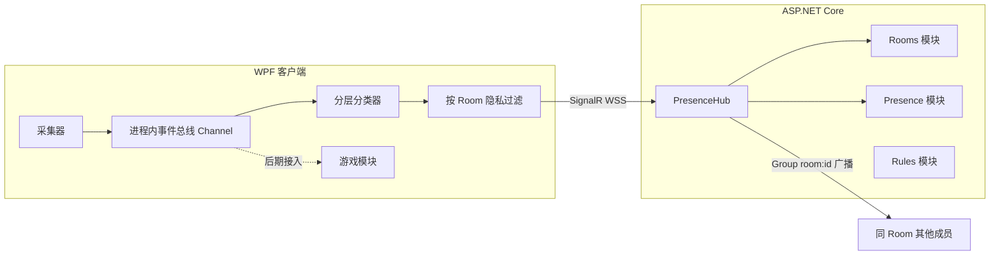

> 第一期开始开发前确认的原方案，原样保留，不随代码更新。当前实际情况见 [architecture.md](architecture.md)，与方案不一致的地方见 [progress.md](progress.md) 的「偏离方案」。

# DeskPal：Windows 状态共享客户端（.NET C#）可行性与实施计划

## 一、可行性结论

可行，并且不需要截图。所有信号都能用 Win32 / WinRT API 在**普通用户权限**下拿到。

关于“尽可能高的系统权限”，建议**不要这么做**：
- Windows Service 运行在 Session 0，看不到用户桌面，反而读不到前台窗口，所以必须以当前用户身份、在登录时自启。
- 键盘钩子、注入、提权这类行为会被公司的 EDR / 杀毒软件判定为键盘记录器或恶意程序，可能触发 IT 告警。
- 管理员权限只在安装时可能用到，运行时不需要。

风险提示：公司电脑上的 DLP / EDR 可能把“持续上报窗口标题”视为数据外泄。因此默认只上报**分类和应用显示名**，窗口标题需要用户主动开启才上报。是否符合公司 IT 规定，需要你们自己确认。

## 二、能采集的信号（均不截图）

- **前台应用**：`SetWinEventHook(EVENT_SYSTEM_FOREGROUND)` 由事件驱动，配合 `GetWindowText`、`GetWindowThreadProcessId` 取进程名和窗口标题；用 `FileVersionInfo.FileDescription` 取应用的友好名称（例如 `cloudmusic.exe` 对应“网易云音乐”）。
- **浏览器当前网站**：原型阶段解析 Chrome / Edge 的窗口标题（标签页标题通常带站点名，例如“xxx_哔哩哔哩_bilibili”），再用 UI Automation 读地址栏，只取**域名**。第二期用浏览器扩展（MV3）加 Native Messaging 提升稳定性。
- **空闲 / 离开**：`GetLastInputInfo`，超过 N 分钟无输入判定为“离开座位”。只读最后一次输入的时间戳，不记录按键。
- **锁屏 / 解锁**：`SystemEvents.SessionSwitch`。
- **开会中**：读注册表 `HKCU\...\CapabilityAccessManager\ConsentStore\microphone`，`LastUsedTimeStop == 0` 表示麦克风正在被占用，再结合 Teams / Zoom / 腾讯会议 / 飞书进程判断。
- **在听 / 在看什么**：WinRT `GlobalSystemMediaTransportControlsSessionManager` 读取当前播放的歌曲或视频标题。
- **全屏**：判断前台窗口是否覆盖整块显示器，用于识别看视频、玩游戏或演示 PPT。
## 三、分类：不需要每个人自己配置

用户**不需要**逐个配置进程名和域名。分类按下面的顺序逐层匹配，命中即停止：

1. **个人覆盖**：用户点了“这条分错了”之后保存在本机的规则，优先级最高。
2. **Room 共享规则**：Room 内任意成员做过的纠正，自动同步给同一 Room 的所有成员。纠正一次，大家都生效。
3. **服务器内置规则库**：开发者维护的默认规则（首批约 300 条，覆盖国内办公常见的应用和网站：微信、钉钉、飞书、B 站、抖音、淘宝、小红书、知乎、Steam、网易云音乐、VS Code、Office 等）。规则库带版本号，客户端启动时拉取增量，更新时不用发新版客户端。
4. **启发式**：
   - 媒体会话正在播放，且前台不是工作类应用，归为 `Music` 或 `Video`。
   - 全屏，且前台不是 Office 或 IDE，归为 `Video` 或 `Game`。
   - 进程路径位于 `steamapps` 目录下，归为 `Game`。
   - 浏览器标题包含站点关键词（例如“哔哩哔哩”“淘宝”），按关键词归类。
5. **未知**：归为 `Other`，对方看到的是应用友好名称（例如“正在使用 XX 应用”），默认按“忙”处理，避免误报摸鱼。

第二期再加一层：客户端把未命中的进程名和域名（只有名字，不含标题）上报到服务器的待归类队列，由服务器批量自动归类（可选接入 LLM）或者由开发者人工审核后，合入内置规则库。

## 四、整体架构（为 Room 和游戏化留扩展点）



扩展性约定（原型阶段就按这几条做，后续不用推倒重来）：
- **数据模型按 Room 设计，不按“一对”设计**：`User`、`Room(Id, Name, OwnerId, MaxMembers, CreatedAt)`、`RoomInvite(RoomId, Code, CreatedBy, ExpiresAt)`、`RoomMember(RoomId, UserId, Role, JoinedAt, PrivacyProfile)`。原型阶段把 `MaxMembers` 固定为 2，界面上只显示一个人。后续放开上限即可变成多人 Room，一个用户也可以加入多个 Room。
- **隐私按 Room 配置**：同一个人在伴侣 Room 里可以显示详情，在同事 Room 里只显示“忙 / 摸鱼”。`PrivacyFilter` 的输入参数是 RoomMember 的配置，而不是全局设置。
- **SignalR 使用 Group**：每个 Room 对应一个 Group `room:{id}`，服务器只向同一 Group 内的成员广播。
- **统一的消息信封**：`{ type, v, roomId, senderId, ts, enc, payload }`。`type` 取值如 `presence.update`、`interaction.poke`、`room.memberJoined`。客户端忽略不认识的 `type`，以后增加 `game.*` 类消息时，旧客户端不会报错。
- **采集和消费解耦**：采集器只负责往事件总线发布 `ActivitySample`，分类器是总线的一个订阅者。以后做类似 Steam 上 Bongo Cat 那种“打字攒道具”的玩法，新增一个游戏模块订阅同一条总线即可。按键计数届时用 Raw Input（只计次数，不读内容），原型阶段不实现。
- **服务器按功能模块分目录**（Rooms / Presence / Rules / Auth），后期新增 Game 模块时不用改动现有模块。

## 五、原型功能范围

第一期（验证原型）：
- 注册登录，创建 Room，生成邀请码，对方输入邀请码加入（上限 2 人）。
- Room 生命周期（参考 QQ 群）：
  - Room 长期存在，不自动删除，也不过期。
  - 每个用户最多创建 N 个 Room（只统计自己是所有者的 Room），N 在 appsettings.json 中配置，原型阶段默认 5。
  - 邀请码 24 小时后过期，任意成员可以重新生成；邀请码过期不影响 Room 本身。
  - 所有者可以解散 Room，解散时删除 Room、成员关系、邀请码和 Room 共享规则。
  - 所有者不能直接退出，必须先把所有者身份转让给其他成员，或者解散 Room，因此 Room 始终有所有者，不会出现空 Room。
  - 普通成员可以随时退出。
- 自动状态：`Working` / `Meeting` / `Communicating` / `Slacking:{Video, Music, Shopping, Social, News, Game, Reading}` / `Other` / `Away` / `Locked` / `Offline`。
- 防抖：状态持续 30 秒以上才上报，避免频繁切换窗口造成刷屏。
- 托盘图标和小浮窗，显示对方当前状态、持续时长和最后更新时间。
- 手动覆盖状态（比如“别打扰”或自定义一句话），一键暂停分享（对方看到“暂停分享”）。
- “戳一下”：对方收到 Windows Toast 通知。
- “这条分错了”：一键把当前应用或域名改成另一个类别，同步给 Room。

第二期：
- 放开 Room 人数上限，支持多人 Room 和多个 Room 之间切换。
- 摸鱼同步提醒：Room 内有人和你同时处于 Slacking 状态时，弹出“对方也在摸鱼，聊两句？”。
- 对方空闲时提醒：对方开会结束或从忙变为空闲时通知我。
- 当天时间轴：按小时聚合各分类的占比，只保存聚合结果，服务器保留 7 天。
- 手机端查看（服务器提供 PWA 网页）、浏览器扩展、未知应用自动归类。
## 六、技术选型与项目结构

- .NET 10（LTS）。客户端用 WPF + `H.NotifyIcon`（托盘）+ `CommunityToolkit.Mvvm` + `Microsoft.Extensions.Hosting`（依赖注入，采集器注册为 `IHostedService`）。Toast 通知用 `Microsoft.Toolkit.Uwp.Notifications`，WinRT API 通过 TFM `net10.0-windows10.0.19041.0` 调用。
- 服务器：ASP.NET Core + SignalR + EF Core。原型阶段用 SQLite，后期人数多了可换 PostgreSQL（EF Core 换 Provider 即可）。JWT 认证，Docker 部署在你的服务器上，前置 Caddy 自动配置 HTTPS。

```
DeskPal.sln
  src/DeskPal.Shared/           消息信封、type 常量、状态枚举、DTO、Hub 接口契约
  src/DeskPal.Server/
    Features/Auth/              注册、登录、JWT
    Features/Rooms/             创建 Room、邀请码、加入 / 退出、成员上限
    Features/Presence/          PresenceHub、成员最新状态缓存
    Features/Rules/             内置规则库（带版本号）、Room 共享规则
    Data/                       EF Core DbContext、迁移
    Dockerfile
  src/DeskPal.Client/
    Collectors/                 Foreground、Idle、Session、Mic、Media、BrowserUrl
    Pipeline/                   ActivitySample、事件总线（System.Threading.Channels）
    Classification/             分层分类器、启发式、规则缓存
    Privacy/                    PrivacyFilter（以 RoomMember 配置为输入）
    Services/                   HubConnectionService（自动重连、离线缓存）、AutoStart（HKCU Run 注册表项）
    Views/                      RoomMemberCard、Settings
  tests/DeskPal.Tests/          分类器、启发式、PrivacyFilter、Room 成员上限的单元测试
```

数据与安全：
- 客户端只上报 `{ state, category, appDisplayName?, detail?, since }`。原始窗口标题不离开本机，除非用户在该 Room 中对该类别开启了“显示详情”。
- 服务器只保存每个成员的最新状态和按小时聚合的统计，不保存原始事件。
- 只用 WSS / HTTPS；Token 存放在 Windows DPAPI（`ProtectedData`）中。

## 七、风险与应对

- 公司 EDR 拦截或告警：不使用钩子注入和提权，可执行文件做代码签名（可选），通信只走 443 端口。
- 公司网络屏蔽 WebSocket：SignalR 会自动降级为 Long Polling。
- UI Automation 读地址栏不稳定（浏览器版本更新后可能失效）：失败时回退到解析窗口标题，第二期用浏览器扩展彻底解决。
- 内置规则库覆盖不全：未知应用默认按“忙”处理，再通过“这条分错了”和第二期的待归类队列逐步补全。
## 八、对外销售时的通信方式与隐私（原型不实现，只预留）

结论：不改 P2P，保持服务器中转，加端到端加密（E2EE），让服务器只能转发密文。

为什么不用 P2P：
- 公司网络普遍封 UDP、使用对称 NAT，打洞成功率低，最后还是要靠 TURN 中继服务器转发，等于又回到了服务器中转。
- 双方必须同时在线，无法保留离线消息、最新状态和时间轴；手机 PWA 也不方便接入。
- 多人 Room 是网状连接，N 个人需要 N(N-1)/2 条连接，人一多就容易有成员连不上。
- 游戏化以后的排行榜、道具、防作弊都需要权威服务器。
- 状态消息每条只有几百字节、几十秒一条，服务器带宽成本很低，用 P2P 省不了多少钱。

服务器集中式的隐私风险和应对：
- 风险：服务器被入侵、运营者（也就是你）能看到所有人在干什么、数据被用于员工监控。
- E2EE：每个成员本地生成密钥对，Room 密钥只在成员之间分发，成员退出时轮换密钥；presence 和互动消息的 `payload` 是密文，服务器无法解密。.NET 自带 `AesGcm` 和 `ECDiffieHellman` 就能实现；多人 Room 规模大了以后可以改用 MLS（RFC 9420）。
- 服务器仍然能看到元数据：谁在哪个 Room、什么时候在线、消息频率。这部分无法靠 E2EE 隐藏，只能靠少存、短期保留来降低风险。
- 需要服务器读明文的功能单独处理：时间轴在客户端聚合后加密保存；游戏只上报按键次数这类不敏感的数字；未知应用的上报需要用户主动开启。
- 防止被当作监控软件：不提供隐藏运行模式，托盘图标始终可见；Room 内成员互相可见，权限对等；每台电脑只能由本人登录。
- 合规：面向国内销售需要满足《个人信息保护法》，包括隐私政策、单独同意、数据最小化；面向海外需要满足 GDPR。

原型阶段为此预留的设计：
- 消息信封增加 `enc` 字段（原型阶段固定为 `none`），服务器只按 `type`、`roomId` 路由，不解析 `payload` 的内容。以后加 E2EE 时只改客户端，服务器和协议都不用改。
- 服务器的 Presence 模块只把最新状态放在内存缓存里，不写入数据库。